# GeoBIM Informatielandschap

Dit hoofdstuk beschrijft welke soorten informatie BIM- en Geo-modellen bevatten en waarin beide domeinen verschillen in opbouw, schaal en detailniveau. Daarnaast komen de frameworks voor detailniveaus (LOIN, LOD en LoD) en de belangrijkste bestandsformaten voor de uitwisseling tussen BIM en Geo aan bod.

# Soorten informatie

Zowel BIM- als Geo-modellen maken deel uit van een breder informatielandschap. In de [[ISO19650-1]] wordt informatie in drie soorten onderverdeeld:

* Geometrisch: 2D- of 3D-modellen, met bijvoorbeeld vormen en hun dimensies
* Alfanumeriek: Gestructureerde data die niet over geometrieën gaat, zoals de kenmerken van objecten.
* Documentatie: Ongestructureerde data zoals PDF-bestanden en foto's.

Deze soorten informatie worden ieder op een andere manier verwerkt, zowel door mensen als software. Het maken van dit onderscheid helpt daarmee ook om de juiste keuzes te maken bij het converteren en beheren van informatie. De nadruk van deze praktijkrichtlijn ligt op geometrische informatie, maar de overige soorten zullen ook behandeld worden.

## Geometrisch model
Geometrische informatie beschrijft waar een object zich bevindt en hoe het eruitziet. Dit omvat onder andere de vorm, afmetingen, positie en ruimtelijke relaties van objecten. De manier waarop geometrie wordt gemodelleerd verschilt per toepassingsgebied en informatiemodel. Zie het hoofdstuk [Geometrie BIM naar Geo](#geometrie-bim-naar-geo) voor een toelichting op de verschillende manieren van het modelleren van geometrie.

## Alfanumeriek

Alfanumerieke informatie kan op allerlei plaatsen en vormen worden bijgehouden. De scheiding tussen alfanumerieke en overige informatie wordt daarom vaak ook niet zo scherp gemaakt in de praktijk. Zo kan het materiaal of bouwjaar van een object als attribuut in een BIM- of GIS-model opgenomen zijn, in een PDF of spreadsheet staan, of als gestructureerde data in een apart systeem beheerd worden. Ook kunnen objecten geclassificeerd worden naar diverse classificatiesystemen, zoals NL-SfB, NLCS of IMBOR.

Bij de stap van BIM naar Geo is het technisch goed mogelijk om alle kenmerken over te nemen, zolang objecten ook 1-op-1 overgenomen worden. De vraag is alleen welke informatie daadwerkelijk relevant is. In een IFC-model kunnen bijvoorbeeld gedetailleerde kenmerken zitten over materiaaleigenschappen of fabrikantdata. Voor het meeste GIS-gebruik is deze informatie niet relevant en zal deze voornamelijk extra ruis opleveren. In deze praktijkrichtlijn zullen een aantal best practices benoemd worden om hiermee om te gaan.

## Documentatie
Omdat documentatie ongestructureerde data bevat, kan deze niet uitgedrukt worden in BIM- of GIS-standaarden. Hierdoor is dit soort informatie ook niet geschikt voor conversie. Er kan wel een link bestaan tussen (geometrische) objecten en documenten (bijvoorbeeld _IfcRelAssociatesDocument_ in IFC of _externalReference_ in CityGML). Het kan nodig zijn om documenten die gekoppeld zijn aan een BIM-model ook te behouden in een Geo-context.

# Verschillen tussen BIM- en Geo-modellen

BIM- en GIS-modellen spelen ieder een eigen rol, en die rollen zijn onlosmakelijk met elkaar verbonden. BIM-modellen representeren een gebouw op een architectonische schaal terwijl GIS-modellen hetzelfde gebouw representeren op een stedelijke schaal. De gebouwen gemodelleerd in BIM-modellen hebben een hoog detailniveau. Objecten zoals kozijnen, deurklinken en scharnieren zijn op een gedetailleerde en precieze manier gemodelleerd. GIS-objecten die dezelfde gebouwen representeren zijn veel simpeler. Kleine details die aanwezig zijn in BIM-modellen worden over het algemeen niet, of niet expliciet, gemodelleerd in GIS.

Er zijn een aantal redenen voor deze verschillen:

* Een GIS-model bevat informatie over grote clusters van gebouwen, mogelijk zelfs van complete steden of op landelijke schaal. De informatie opslaan op een BIM-schaal voor deze gebieden zal zeer zware modellen opleveren die lastig, zo niet onmogelijk, zijn om mee te werken.
* GIS-data en -formaten zijn ontwikkeld om te werken met data die op basis van andere bronnen is ingewonnen dan BIM. Waar in BIM vaak handmatig wordt gemodelleerd (al dan niet aangevuld door scripts of ai) worden de meeste GIS-modellen gebaseerd op metingen. Voor gebouwen zijn deze metingen vaak LiDAR-scans. De data afkomstig van deze scans kunnen ruis en occlusie (gaten in de metingen) bevatten en hebben een beperkte resolutie. Met deze data is het niet mogelijk om snel op grote schaal zeer gedetailleerde modellen te creëren.
* GIS-modellen spelen vaker een publieke rol dan BIM-data. GIS-data is beschikbaar voor gebruikers om te downloaden en te verwerken. Als GIS-data alle informatie over de opgeslagen gebouwen zou bevatten, zoals in BIM-modellen, zou dit mogelijk tot privacy- en dataveiligheidsproblemen leiden. Aanvullend zal er dan ook zoveel data beschikbaar zijn, waardoor de gebruiker door de bomen het bos niet meer ziet. Bovendien zit in BIM-modellen data waarvoor het niet in het belang van de ontwerper is om deze data te delen. Op deze data kunnen auteursrechten rusten.

Om enerzijds in een GIS-omgeving te kunnen worden toegepast en anderzijds in een BIM-omgeving, zijn GIS-data en BIM-data op een verschillende manier opgebouwd. Geometrisch gezien is een gebouw in een BIM-model geconstrueerd uit verschillende losse objecten. Wanden, vloeren en deuren zijn allemaal volumetrische objecten die samen een bouwwerk vormen. In GIS-modellen is deze omsluiting gerepresenteerd als een enkel object. Losse objecten, zoals losse wanden, vloeren en deuren, komen in GIS-modellen relatief weinig voor. Een gebouw in GIS kan worden gezien als een gesloten schil die de grens tussen het gebouw en de lucht aanduidt.

<figure id="Verschil_IFC_GIS" style="display: block; text-align: center; margin: 0 auto;">
      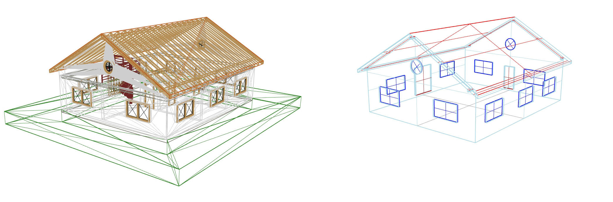
      <figcaption> Een wireframe representatie van een BIM-model (links) en een exterieur GIS-model (rechts).
      </figcaption>
</figure>

De manier waarop ruimtes binnen het gebouw worden gerepresenteerd, is daarentegen wel vergelijkbaar tussen BIM- en volumetrische GIS-modellen. Beide gebruiken een enkele volumetrische vorm om een unieke ruimte binnen een gebouw aan te duiden. Deze volumetrische vorm kan worden gezien als een gesloten schil die de grens tussen het gebouw en de lucht van een ruimte aanduidt.

<figure id="Verschil_IFC_GIS_kamers" style="display: block; text-align: center; margin: 0 auto;">
      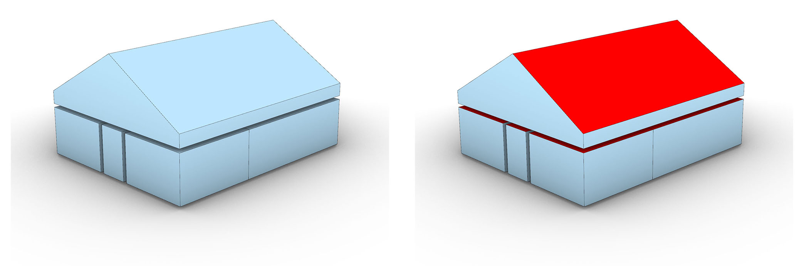
      <figcaption> Representatie van de kamers in een BIM-model (links) en GIS-model (rechts).
      </figcaption>
</figure>

Over het algemeen is een gebouw in een BIM-bestand op het hoogst beschikbare detailniveau gerepresenteerd. In een GIS-bestand is dit vaak niet het geval. Een gebouw kan op meerde manieren gerepresenteerd worden in een enkel GIS-bestand. Dit kan variëren van (vanuit GIS bezien) zeer gedetailleerde volumetrische vormen tot zeer versimpelde niet-volumetrische oppervlakte. Deze variatie in representaties is aanwezig om toepassingen op verschillende detailniveaus mogelijk te maken, maar ook omdat GIS-databronnen niet altijd alle data beschikbaar hebben om alle bouwwerken op dezelfde manier te reconstrueren. Het is dus mogelijk om data met lagere precisie te combineren met  data met hogere precisie indien er beperkte databronnen beschikbaar zijn. Om de verschillende kwaliteit van de representaties aan te duiden wordt in 3D-GIS de term Level of Detail (LOD) gebruikt. In BIM wordt de informatiebehoefte, inclusief decompositie en detail, beschreven met het Level of Information Need (LOIN). Daarnaast wordt in de BIM-praktijk nog vaak het Level of Development gebruikt, dat ook als LOD wordt afgekort. Die gelijke afkorting zorgt soms voor verwarring. De volgende paragrafen lichten de drie begrippen toe.

Dat de termen GIS Level of Detail (LOD) en BIM Level of Development (LOD) dezelfde afkorting gebruiken, zorgt soms voor verwarring. 
 
## Level of Information Need in BIM
De ISO 19650-serie schrijft voor dat een opdrachtgever vastlegt welke informatie die opdrachtgever nodig heeft. Hoe je die informatiebehoefte per object beschrijft, staat in NEN-EN-ISO 7817-1:2024 [[ISO7817-1]] (de opvolger van NEN-EN 17412-1:2020). Deze methode heet het Level of Information Need (LOIN).

Het LOIN is geen schaal met vaste niveaus. Het is een manier om per informatie-uitwisseling vast te leggen waarom informatie nodig is en welke informatie daar invulling aan kan geven. Hetzelfde object kan daardoor in één project meerdere informatiebehoeften hebben: een wand vraagt voor een kostenraming om andere informatie dan voor een omgevingsvergunning of voor een conversie naar een 3D-stadsmodel.

**Informatiedoel**
Voordat men bepaalt hoe gedetailleerd een object moet zijn, legt men vier dingen vast. Zonder deze voorwaarden is een informatiebehoefte niet te beoordelen: "gedetailleerd genoeg" bestaat alleen ten opzichte van een doel.

<table>
  <caption> Voorwaarden voor het bepalen van een Level of Information Need </caption>
  <tr>
    <th style = "width:200px;"> Voorwaarde </th>
    <th style = "width:500px;"> Beschrijving </th>
  </tr>
  <tr>
    <td> Doel </td>
    <td> Het doel beschrijft waarvoor men de informatie gebruikt. Bijvoorbeeld: toetsing van de maximale bouwhoogte in een omgevingsvergunning, of het afleiden van een LOD2-gebouwmodel. </td>
  </tr>
  <tr>
    <td> Leveringsmoment </td>
    <td> Dit aspect definieert op welk moment in het proces de informatie beschikbaar moet zijn. Bijvoorbeeld: bij de vergunningaanvraag of bij de oplevering. </td>
  </tr>
  <tr>
    <td> Actoren </td>
    <td> Hiermee maakt men duidelijk welke actor de informatie levert, welke actor ontvangt, en welke actor gebruikt. Bijvoorbeeld: de ontwerpende partij levert, de gemeente of de beheerder van een basisregistratie ontvangt. </td>
  </tr>
  <tr>
    <td> Object en decompositie </td>
    <td> Object en decompositie stelt de mate van decompositie van het object in onderdelen. Men kan een afvalbak als één geheel modelleren, of in twee delen met een losse bak en een losse poer, of nog verder gedecomponeerd. </td>
  </tr>
</table>

**Informatiebehoefte**

Per object en per doel wordt de informatiebehoefte uitgesplitst in de drie soorten informatie: geometrische informatie, alfanumerieke informatie en documentatie. Voor geometrische informatie worden afspraken gemaakt over vijf aspecten:

<table>
  <caption> Aspecten van geometrische informatie in het Level of Information Need </caption>
  <tr>
    <th style = "width:200px;"> Aspect </th>
    <th style = "width:500px;"> Beschrijving </th>
  </tr>
  <tr>
    <td> 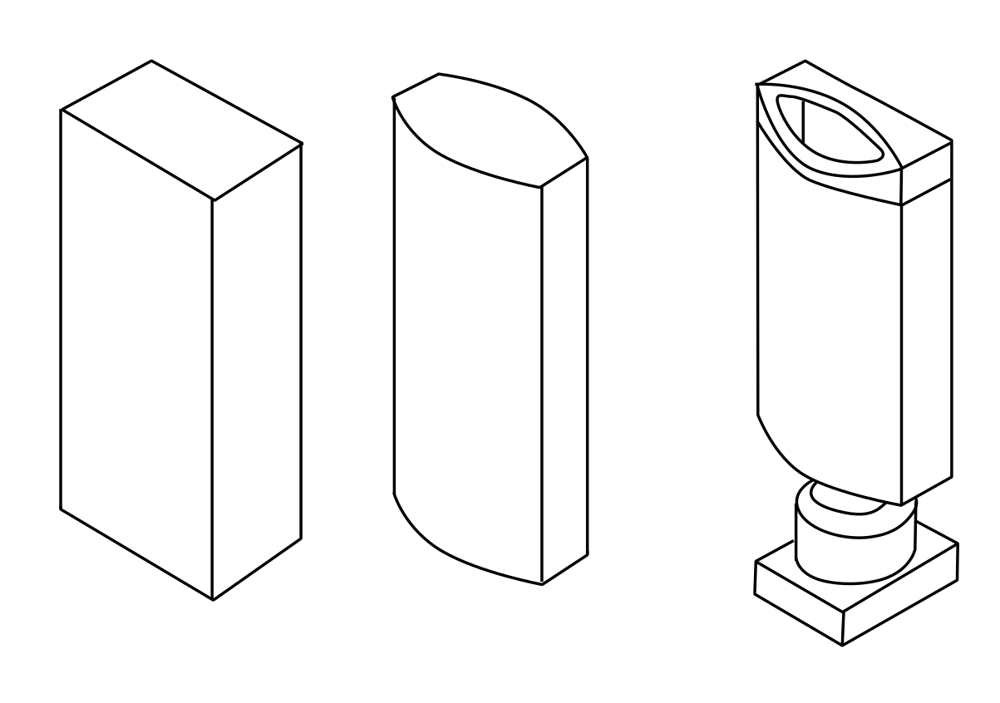 Detail </td>
    <td> Beschrijft het detail van de geometrie van het object vergeleken met het object in de werkelijkheid. De Level of Development-niveaus van het BIMForum kan men gebruiken om dit detailniveau te duiden. Dit geldt per objecttype en niet voor het hele model. Zie <a href="#level-of-development-in-bim">Level of Development in BIM</a>. </td>
  </tr>
  <tr>
    <td> 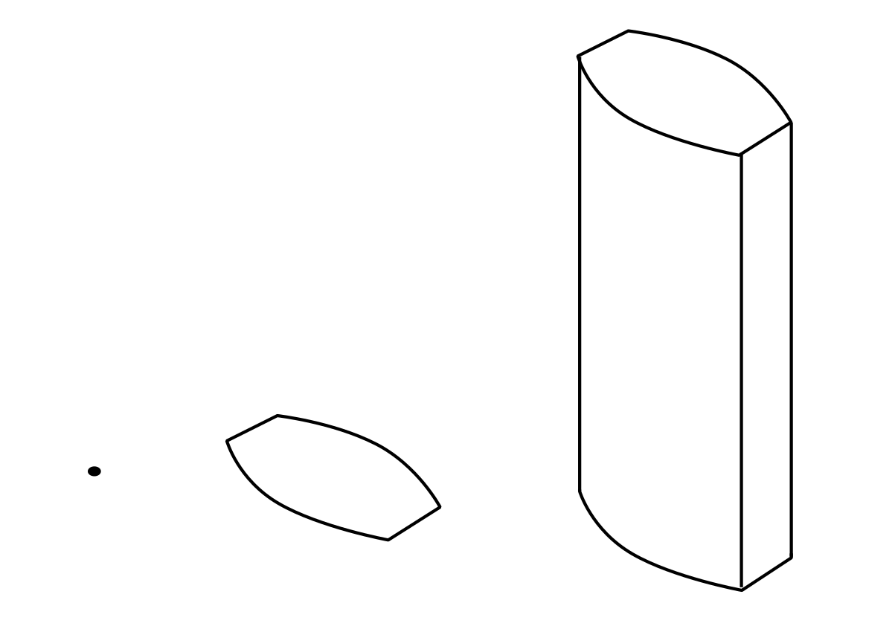 Dimensie </td>
    <td> Deze waarde beschrijft in hoeveel dimensies een object wordt weergegeven: 0D, 1D, 2D of 3D. Hogere dimensies zijn mogelijk wanneer bijvoorbeeld tijd of metingen worden toegevoegd. </td>
  </tr>
  <tr>
    <td> 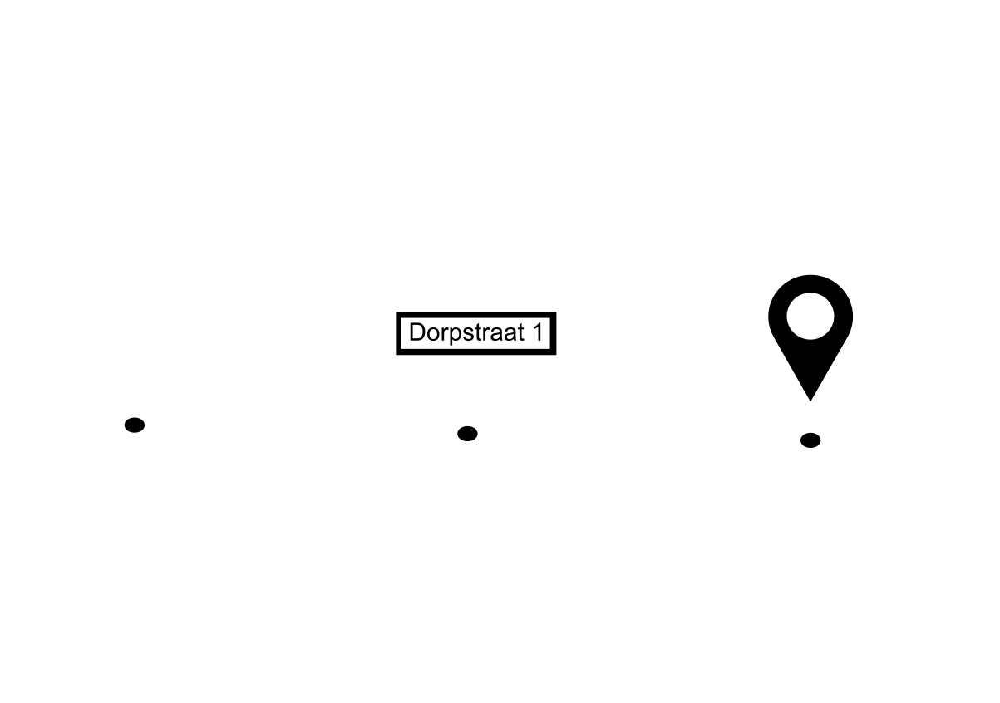 Locatie </td>
    <td> Deze waarde duidt hoe de plaats van een object is vastgelegd. Bijvoorbeeld absoluut in een coördinatenstelsel of relatief ten opzichte van een ander object. Voor conversie naar Geo is dit aspect bepalend, omdat het object zonder absolute locatie niet in een geo-omgeving kan worden geplaatst. </td>
  </tr>
  <tr>
    <td> 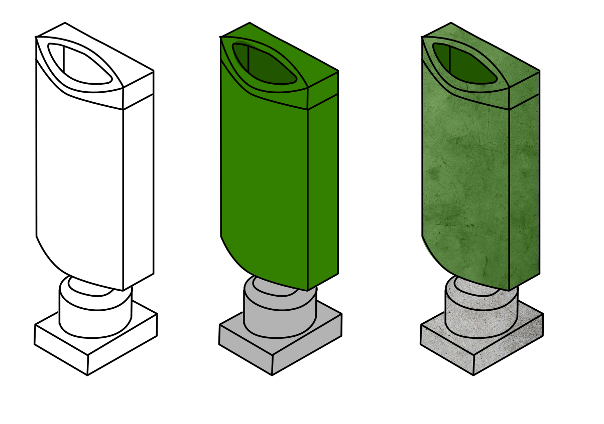 Voorkomen </td>
    <td> Dit attribuut specificeert de kleur en/of textuur van een object, en in hoeverre die overeenkomt met het object in de werkelijkheid </td>
  </tr>
  <tr>
    <td> 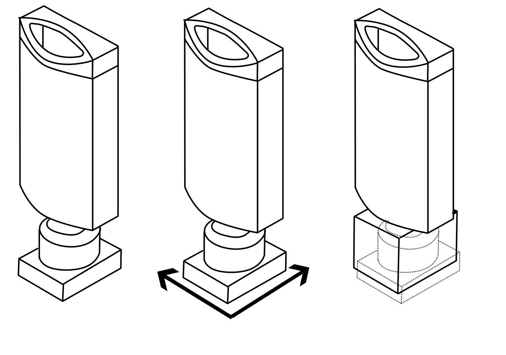 Parametrische functionaliteit </td>
    <td> Beschrijft of een object na levering nog aanpasbaar is, en zo ja, hoe. </td>
  </tr>
</table>

Het LOIN geeft met alfanumerieke informatie de mogelijkheid om vast te leggen welke niet-geometrische attributen bij een object vastgelegd dienen te worden. Bijvoorbeeld entiteit-type, classificatie of eigenschappen. Met documentatie stelt men in het LOIN vast welke documenten, zoals tekeningen, certificaten of rapporten, aan een object gekoppeld moeten zijn.

<aside class="note" title="Gebruik het Level of Information Need als uitgangspunt">
  <p><strong>AANBEVELING:</strong> Gebruik het Level of Information Need (NEN-EN-ISO 7817-1) om de informatiebehoefte voor BIM-naar-Geo-conversie vast te leggen: per object, per doel en per leveringsmoment. Leg de alfanumerieke eisen vast in een IDS. Level of Development-niveaus mogen als aanvulling worden gebruikt om het aspect detail te omschrijven. Het LOIN is leidend.</p>
</aside>

## Level of Development in BIM
In de BIM-praktijk wordt nog veel gewerkt met het Level of Development (LOD) van het BIMForum [[BIMFORUM-LOD]], oorspronkelijk opgesteld door het American Institute of Architects (AIA). De volledige omschrijvingen per niveau staan in [bijlage G](#level-of-development). Het BIMForum onderscheidt de volgende niveaus:

- **LOD 100 – Conceptniveau**
- **LOD 200 – Globale geometrie**
- **LOD 300 – Nauwkeurige geometrie**
- **LOD 350 – Nauwkeurige geometrie met aansluitingen**
- **LOD 400 – Geschikt voor fabricage en uitvoering**
- **LOD 500 – As built**

<figure id="LODS-van-een-kolom" style="display: block; text-align: center; margin: 0 auto;">
      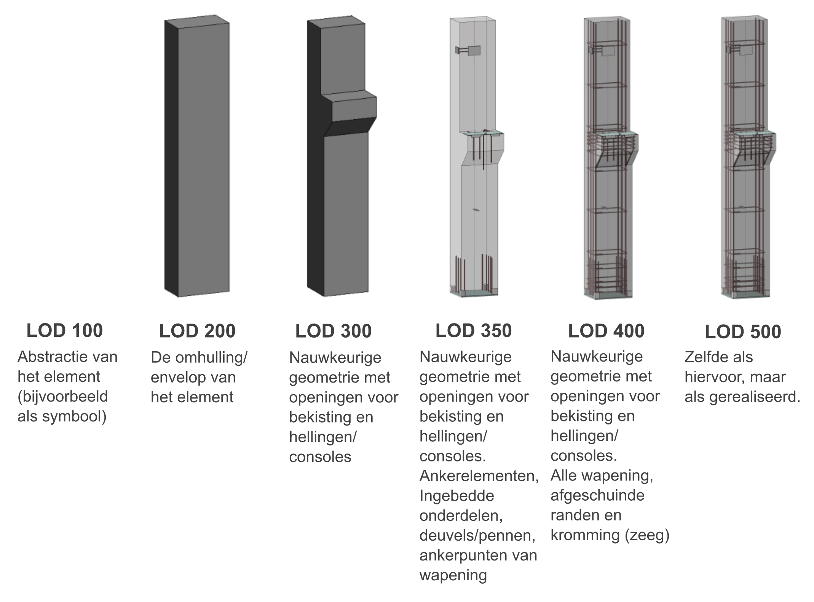
      <figcaption>
        <a class="self-link" href="#LODS-van-een-kolom"></a>
        <span class="fig-title">
        Verschillende LOD's van een kolom <br> 
        Copyright © 2025 by BIMForum, All rights reserved, CC BY-NC-ND 4.0 <br>
        <a href="https://bimforum.org/resource/lod-level-of-development-lod-specification/" >Level of Development (LOD) Specification</a>
        </span>
      </figcaption>
</figure>

Het Level of Development legt met één getal (LOD 100, LOD 200, enzovoort) tegelijk detail, betrouwbaarheid, beoogd gebruik en projectfase vast. Meestal wordt dat getal voor het hele model afgesproken, en het is niet te herleiden tot toetsbare eigenschappen in IFC. Het Level of Information Need is de genormeerde opvolger: het splitst deze onderdelen uit per object en per doel, en stemt de geometrische, alfanumerieke en documentgebonden informatie af op het beoogde gebruik. Wie met LOD-niveaus werkt, kan de omschrijving van een LOD-niveau voor geometrie gebruiken als waarde voor het aspect *Detail* binnen een LOIN. Zie [bijlage G Level Of Development](#level-of-development) voor een meer uitgebreide toelichting op de BIM-LOD-levels.

## Level of Detail (LOD) Framework in GIS
In GIS wordt “Level of Detail” gebruikt om aan te geven hoe gedetailleerd een GIS-model is in relatie tot het object in werkelijkheid. 

De GIS Level of Details worden gedefinieerd in de [CityGML 3.0](https://docs.ogc.org/guides/20-066.html#overview-section-levelsofdetail)-standaard [[CITYGML30]]. De standaard definieert 4 hoofdniveaus, LOD0 tot LOD3. Hierbij krijgt de geometrie van een model bij hoger LOD-niveau meer detail. De hoofdniveaus worden breed ondersteund in toepassingen.

De documentatie van CityGML over LOD is algemeen. De volgende definities kunnen worden gegeven ten aanzien van gebouwen:

<table>
  <caption> LOD van een gebouw zoals beschreven in de CityGML3.0-standaard </caption>
  <tr>
    <th> Level </th>
    <th> Beschrijving </th>
  </tr>
  <tr>
    <td> LOD0 </td>
    <td> Een representatie van een gebouw of vertrek met niet-volumetrische geometrie zoals een punt, vlak (polygoon) of meerdere vlakken (voor bijvoorbeeld de 'footprint' of 'roofprint'). </td>    
  </tr>
   <tr>
    <td> LOD1 </td>
    <td>  Een representatie van een gebouw of vertrek als een blok- of prismavorm. </td>    
  </tr>
   <tr>
    <td> LOD2 </td>
    <td> Een representatie van een gebouw of vertrek als een volume met (meestal) verticale muren, waarbij de vlakken die het dak representeren zijn verfijnd. </td>    
  </tr>
   <tr>
    <td> LOD3 </td>
    <td> Een representatie van een gebouw of vertrek als een schil of een collectie van constructieve elementen. Dit is de enige LOD die gevelopeningen ondersteunt. </td>    
  </tr>
</table>


<figure id="Voorbeeld-van-de-4-LoDs-beschreven-door-de-CityGML3-0-standaard" style="display: block; text-align: center; margin: 0 auto;">
      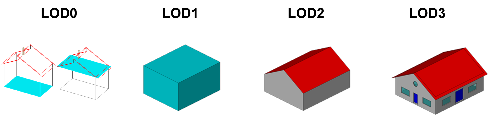
      <figcaption>
        <a class="self-link" href="#Voorbeeld-van-de-4-LoDs-beschreven-door-de-CityGML3-0-standaard"></a>
        <span class="fig-title">
        Voorbeeld van de 4 LODs van een gebouw beschreven door de <a href="https://docs.ogc.org/guides/20-066.html#overview-section-levelsofdetail" >CityGML3.0-standaard</a>.
        </span>
      </figcaption>
</figure>

De in CityGML3.0-standaard beschreven LODs kunnen worden gebruikt voor zowel exterieur als interieur. In CityGML 2.0 was er een aparte LOD die interieur ondersteunde, LOD4. Deze was anders opgebouwd dan LOD0-3. LOD0-3 kent een structuur waarbij de buitenkant een enkele schil is die het model representeert. LOD4 volgt een BIM-achtige structuur waarbij de representatie van het gebouw bestaat uit losse objecten. LOD4 kan worden geïnterpreteerd als een (gefilterde) 1 op 1 conversie van een BIM-model.

In CityGML3.0 is de rol van LOD3 veranderd om de BIM-achtige structuur te ondersteunen die voorheen onder LOD4 viel. Dit betekent dat LOD3 kan zijn opgebouwd als een schilmodel maar ook als een collectie van constructieve elementen. Hoewel LOD4 officieel niet meer wordt ondersteund, komt het in de praktijk nog voor. In deze modellen is LOD3 opgebouwd als een schilmodel en LOD4 als een collectie van constructieve elementen.

In de praktijk wordt het LOD-framework vooral gebruikt voor gebouwen. Bouwwerken zoals bruggen, tunnels en sluizen worden in de documentatie niet zo uitgebreid beschreven als gebouwen. In theorie kunnen de LODs ook toegepast worden op deze bouwwerken omdat het LOD-framework van CityGML open en flexibel is. De verschillende LOD-abstracties van infrastructurele bouwwerken lijken minder bruikbaar omdat gebouwen en infrastructurele bouwwerken erg van vorm verschillen. 

<figure id="Voorbeeld-van-de-4-LoDs-beschreven-door-de-CityGML3-0-standaard-toegepast-op-een-brug-model" style="display: block; text-align: center; margin: 0 auto;">
      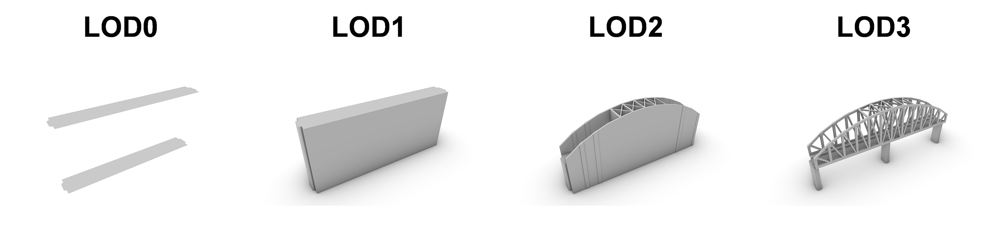
      <figcaption>
        <a class="self-link" href="#Voorbeeld-van-de-4-LoDs-beschreven-door-de-CityGML3-0-standaard-toegepast-op-een-brug-model"></a>
        <span class="fig-title">
        Voorbeeld van de 4 LODs beschreven door de <a href="https://docs.ogc.org/guides/20-066.html#overview-section-levelsofdetail" >CityGML3.0-standaard</a> toegepast op een brugmodel.
        </span>
      </figcaption>
</figure>

<aside class="note" title="LOD voor bruggen en tunnels">
  <p><strong>AANBEVELING:</strong> Verzamel de wensen voor GIS-representaties van bruggen en tunnels. Onderzoek op basis hiervan welke aanpassingen aan de huidige LOD-frameworks nodig zijn. </p>
</aside>

**Verfijnd LoD-framework 3D Geoinformation, TU Delft**

Het CityGML LOD-framework is relatief open en generiek. Dit maakt het makkelijk om een model in het framework te passen. Maar daarmee is het soms ook moeilijk om precies vast te stellen hoe een abstractie het originele gebouw in de werkelijkheid weergeeft. In 2016 hebben Biljecki et al. [[BILJECKI2016]] daarom een verfijning gemaakt die voortbouwt op het CityGML2.0 LOD-framework. Dit is gedaan door iedere CityGML LOD op te splitsen in vier subgroepen. Zo is LOD1 opgesplitst in LoD1.0, 1.1, 1.2 en 1.3. Het eerste nummer van de verfijnde LoD komt overeen met de CityGML LOD. Het tweede nummer geeft de verdere verfijning aan. De documentatie van de verfijnde LoD is uitgebreider dan die van de CityGML-standaard. Ontwikkelingen in 3D-data-inwinning en modellering alsmede gebruik in de praktijk en de zo opgedane ervaringen, leiden voortdurend tot inzichten die de standaard en LoD-beschrijvingen kunnen verbeteren.

Op basis van meerdere bronnen kunnen de LoDs van het verfijnde framework op de volgende manier worden gedefinieerd:

<table>
  <caption> Uitbreiding van het LoD-framework </caption>
  <tr>
    <th style = "width:75px;"> Level </th>
    <th> Beschrijving </th>
  </tr>
  <tr>
    <td> LoD0.0 </td>
    <td> Voetafdruk, dakuitlijn of geprojecteerde omtrek van gebouwen of onderdelen die groter zijn dan 6m. De representaties van gebouwen die aan elkaar grenzen mogen worden samengevoegd </td>
  </tr>
  <tr>
    <td> LoD0.1 </td>
    <td> Een 2D-projectie van alle "grote" elementen van een gebouw (>4m, > 10m2) geplaatst op grondniveau. De representaties van gebouwen die aan elkaar grenzen mogen worden samengevoegd  </td>    
  </tr>
  <tr>
    <td> LoD0.2 </td>
    <td> Een 2D-projectie van alle elementen van een gebouw geplaatst op grondniveau en optioneel aangevuld door een 2D-projectie op dakhoogte.</td>
  </tr>
  <tr>
     <td> LoD0.3 </td>
    <td> Een 2D-projectie van alle elementen van een gebouw geplaatst op grondniveau en aangevuld met een 2D-projectie van alle losse dakelementen geplaatst op de tophoogte van ieder element. </td>
  </tr>
  <tr>
     <td> LoD1.0 </td>
     <td> Een opwaartse extrusie van de LoD0.0 voetafdruk of neerwaartse extrusie van de LoD0.0 dakuitlijn naar een afgesproken hoogte </td>
  </tr>
    <tr>
     <td> LoD1.1 </td>
     <td> Een opwaartse extrusie van LoD0.1 naar de afgesproken gebouwhoogte (vaak de noklijn) (of neerwaartse extrusie van de dakuitlijn). </td>
  </tr>
  <tr>
     <td> LoD1.2 </td>
     <td> Een opwaartse extrusie van LoD0.2 naar de afgesproken gebouwhoogte (vaak de noklijn) of neerwaartse extrusie van de dakuitlijn. </td>
  </tr>
  <tr>
     <td> LoD1.3 </td>
     <td> LoD1.2-vorm verrijkt met de meerdere horizontale LoD0.3 dakelementen, indien deze een minimaal hoogtesprong hebben (bijvoorbeeld 2m) tot grondniveau en samengevoegd tot een enkel volume</td>
  </tr>
  <tr>
     <td> LoD2.0 </td>
     <td> Een neerwaartse extrusie van ieder groot dakelement (>4m, > 10m2) tot grondniveau samengevoegd tot een enkel volume. </td>
  </tr>
  <tr>
     <td> LoD2.1 </td>
     <td> Een neerwaartse extrusie van ieder dakelement tot grondniveau (of opwaartse extrusie van het grondvlak tot het dakelement) samengevoegd met het dakelement tot een enkel volume. Het verschil met LoD2.0 is dat kleine details zoals uitstulpingen (groter dan 2 vierkante meter) ook worden meegenomen </td>
  </tr>
  <tr>
     <td> LoD2.2 </td>
     <td> Een neerwaartse extrusie van ieder dakelement en dakbovenbouw (zoals dakkapellen) met minimale omvang tot grondniveau samengevoegd met het dakelement tot een enkel volume. Het kan ook gaan om een opwaartse extrusie van het grondvlak tot het dakelement </td>
  </tr>
  <tr>
     <td> LoD2.3 </td>
     <td> LoD2.2 uitgebreid met expliciet gemodelleerde overhang als deze groter is dan bijvoorbeeld 0.2m. In dit geval worden dus de werkelijke geometrieën van roofprints en footprints gebruikt, waardoor het volume nauwkeuriger is </td>
  </tr>
  <tr>
     <td> LoD3.0 </td>
     <td> LoD2.2 aangevuld met gedetailleerde informatie over dakstructuren, zoals ramen op het dak. Dakkapellen of ramen in muren worden niet meegenomen. </td>
  </tr>  
  <tr>
     <td> LoD3.1 </td>
     <td> LoD2.2 aangevuld met gedetailleerde informatie verkregen vanaf de grond, d.w.z. terrestrische inwinning (in tegenstelling tot LoD3.0). Deze LoD kan uitkragingen/overhang, ramen en deuren bevatten, met LoD3.2 detail op de gevel (façade). </td>
  </tr>  
  <tr>
     <td> LoD3.2 </td>
     <td> Gedetailleerd schilmodel van het gebouw met elementen die groter zijn dan (bijvoorbeeld) 1m. </td>
  </tr>  
  <tr>
     <td> LoD3.3 </td>
     <td> Gedetailleerd schilmodel van het gebouw met elementen die groter zijn dan (bijvoorbeeld) 0.2m. </td>
  </tr>  
</table>


<figure id="Voorbeeld-van-de-16-LoDs-beschreven-door-de-TUDelft" style="display: block; text-align: center; margin: 0 auto;">
      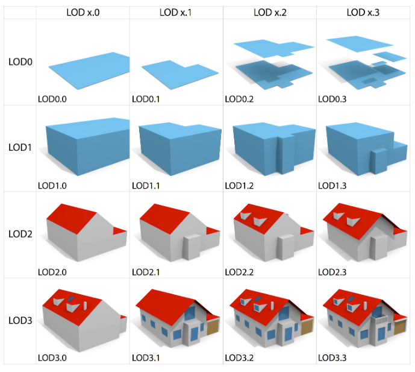
      <figcaption>
        <a class="self-link" href="#Voorbeeld-van-de-16-LoDs-beschreven-door-de-TUDelft"></a>
        <span class="fig-title">
        Voorbeeld van de 16 LoD's beschreven door de  <a href="https://3d.bk.tudelft.nl/lod/" >TU Delft</a> in 2016.
        </span>
      </figcaption>
</figure>

Dit framework is een verfijning van de eisen voor de LoD-abstracties ten opzichte van het CityGML2.0/3.0 LOD-framework maar kan nog steeds tot verschillende interpretaties leiden. Een van de onduidelijkheden betreft het gebruik van een voetafdruk of een geprojecteerd dakcontour bij de verschillende volumetrische LoD-representaties die gebaseerd zijn op extrusie (LoD1.x en 2.x). Het gebruik van een van beide wordt niet duidelijk beschreven of uitgesloten door het framework. Hierdoor wordt in de praktijk de dakcontour (dakuitlijn), de voetafdruk of een andere brongeometrie (zoals de geprojecteerde maximale omvang) gebruikt. Dit kan resulteren in verschillende representaties van hetzelfde gebouw zonder dat dit expliciet vermeld wordt. Zie meer hierover bij het hoofdstuk [Uitbreidingen & aanpassingen van de LoD-frameworks](#uitbreidingen-aanpassingen-van-de-lod-frameworks)

<aside class="note" title="voetafdruk (BGT) vs roofoutline vs geprojecteerde maximale omtrek (BAG)">
  <p><strong>AANBEVELING:</strong> Ontwikkel een duidelijke standaard voor het aangeven van brongeometrie voor de LoD1.x- en 2.x-extensies: voetafdruk, geprojecteerde maximale omtrek, roof outline, 2DBAG, 2DBGT. Het LoD-framework van de TUD kan hiervoor worden aangepast om duidelijk te maken welke brongeometrie gebruikt is voor de extrusie voor de betreffende LoD-groepen (LoD1.x en 2.x). </p>
</aside>

Dit aangepaste LoD-framework is ontwikkeld voor gebouwen en niet voor infrastructurele bouwwerken zoals bruggen, tunnels en sluizen. Er zijn wel initiatieven om LoDs van andere type objecten dan bouwwerken te definiëren, zoals voor [vegetatie](https://repository.tudelft.nl/record/uuid:8b8967a8-0a0f-498f-9d37-71c6c3e532af), [infrastructuur/transport](https://isprs-archives.copernicus.org/articles/XLII-4-W10/89/2018/) en [terrein](https://isprs-annals.copernicus.org/articles/IV-4-W8/75/2019/). Deze worden ook gebruikt in de praktijk, ook al is dat minder dan het verfijnde LoD-framework voor gebouwen.

## Uitbreidingen & aanpassingen van de LoD-frameworks

Zowel het CityGML2.0 LOD-framework, het CityGML3.0 LOD-framework, als het TU Delft verfijnde framework worden gebruikt in de praktijk. Modellen die in de praktijk beschikbaar zijn passen soms niet helemaal op deze LOD-frameworks, mede omdat er recent technologieën beschikbaar zijn gekomen die het mogelijk maken om GIS-modellen te genereren op andere manieren. Bij het opstellen van de bestaande frameworks werd uitgegaan van de destijds beschikbare inwintechniek van metingen om de LOD-abstracties te vormen. De CityGML1.0 LOD-standaard werd geïntroduceerd in 2008 en versie 3.0 is nog steeds in grote lijnen vergelijkbaar met versie 1.0. De TU Delft verfijning is uit 2016. Het is daarom ook belangrijk dat er onderzoek gedaan wordt naar uitbreidingen en aanpassingen van de bestaande LOD-frameworks afgestemd op nieuwe mogelijkheden. 
Voor de voorliggende praktijkrichtlijn is het met name relevant om te kijken naar BIM als databron voor 3D-GIS-bestanden en hoe en welke bestaande, nieuwe of aangepaste LoDs hiermee kunnen worden gegenereerd. 

In 2025 is er onderzoek gedaan naar mogelijke aanvullende LoDs voor GIS-modellen die rekening houden met BIM als databron. In de publicatie "Defining LoDs to support BIM-based 3D building abstractions in GIS" [[VANDERVAART2025]] zijn aanvullingen beschreven op het LoD-framework zodat men rekening kan houden met de unieke beperkingen, maar vooral ook mogelijkheden van BIM-modellen. LoDe.1, een van de experimentele LoD op basis van dit onderzoek zijn ontwikkeld, wordt op dit moment toegepast voor visualisatie door de gemeente Eindhoven als alternatief voor 1 op 1 vertaling.

<figure id="LoDe1-gemeente-endhoven" style="display: block; text-align: center; margin: 0 auto;">
      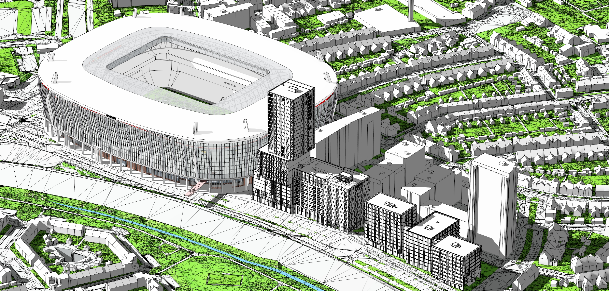 
      <figcaption>
        <a class="self-link" href="#LoDe1-gemeente-endhoven"></a>
        <span class="fig-title">
        Voorbeeld van het 3D-stadsmodel van de gemeente Eindhoven dat is verrijkt met LoDe.1 modellen via de IfcEnvelopeExtractor. Deze modellen worden omringd door LoD2.2-modellen. 
        </span>
      </figcaption>
</figure>

Een formeel en vastgesteld standaard LOD-framework voor BIM- en geo-modellen maakt mogelijk dat men kan stellen: dit BIM-model voldoet aan LOD X en kan volgens transformatieprofiel Y worden geëxporteerd naar een LoD Z Geo-model.

<aside class="note" title="Gestandaardiseerd LOD-framework">
  <p><strong>AANBEVELING:</strong> Breid het bestaande LoD-framework uit om LoDs te standaardiseren op nationaal of internationaal niveau ten behoeve van BIM-naar-Geo-conversie. </p>
</aside>

**Voetafdruk of dakomtrek (of andere geprojecteerde gebouwomtrek) als extrusiebron**

LoD1, 2, 1.2, 1.3, 2.1, 2.2 en 2.3 zijn vormen die gemaakt zijn door een oppervlak te extruderen. Het is van belang dat gespecificeerd wordt welke oppervlaktes de basis (= extrusiebron) vormen voor het genereren van deze volumetrische vorm. Een model dat gebaseerd is op de voetafdruk zal in de meeste gevallen een andere vorm hebben dan het model dat is gebaseerd op de dakomtrek. Veel gebouwen hebben een dak dat over de gevel (en ook de voetafdruk) heen uitsteekt. Bij deze gebouwen zal een extrusie gebaseerd op de dakomtrek dus groter uitvallen dan een extrusie gebaseerd op de voetafdruk. De keuze om òf voetafdruk òf dakomtrek òf een andere bron/vorm te gebruiken, is meestal afhankelijk van welke van deze geometrieën voorhanden is. Het is belangrijk om hier expliciet in te zijn. 

<figure id="Verschil-tussen-footprint-roofedge" style="display: block; text-align: center; margin: 0 auto;">
      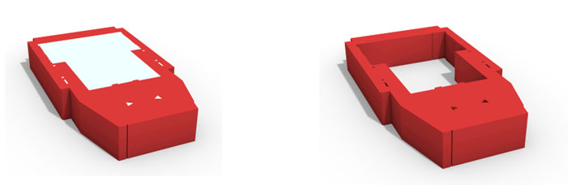 
      <figcaption>
        <a class="self-link" href="#Verschil-tussen-footprint-roofedge"></a>
        <span class="fig-title">
        Deze LoD1.2-representatie van het aulagebouw van de TU Delft is gebaseerd op de dakomtrek (links). Met rood is het deel aangegeven dat zou vervallen ten opzichte van een op voetafdruk gebaseerde extrusie. Het vervallen deel is rechts geïsoleerd weergegeven. Het verschil in volume tussen de twee resulterende vormen is ongeveer 54.000m<sup>3</sup> 
        </span>
      </figcaption>
</figure>

In de CityGML 3.0-standaard [[CITYGML30]] wordt de term "voetafdruk" genoemd als [bronoppervlak voor de extrusie van ruimtes](https://docs.ogc.org/is/20-010/20-010.html#toc30), maar voor de extrusie van de buitenschil is het onduidelijk wat de databron kan zijn. In het TUD verfijnde LoD-framework van Biljecki et al. [[BILJECKI2016]] worden voetafdruk én dakomtrek als opties genoemd: "LOD0 is a representation of footprints and optionally roof edge polygons marking the transition from 2D to 3D GIS. LOD1 is a coarse prismatic model usually obtained by extruding an LOD0 model.". Op basis van dit framework kan een LoD1 zowel gebaseerd zijn op de voetafdruk als op de dakomtrek. Bij de LoD2.x-groep wordt beschreven dat: "When roof overhangs are not available, the walls are usually obtained as projections from the roof edges to the ground, inherently increasing the volume of the building". De LoD2.x-modellen kunnen volgens dit framework dus ook gebaseerd zijn op zowel de dakomtrek als de voetafdruk.

Daarnaast worden de termen "voetafdruk/footprint" en "dakuitlijn/dakomtrek" niet altijd consistent gebruikt. Zo kunnen bijvoorbeeld polygonen die de dakuitlijn van hetzelfde gebouw representeren verschillende vormen hebben afhankelijk van de interpretatie/gebruik van dit concept.

De term "dakuitlijn" of "dakomtrek" kan worden gebruikt voor een polygoon die de projectie van het bovenaanzicht van een gebouw/model representeert. Deze term wordt echter soms ook gebruikt voor de 2DBAG-polygoon, of in ieder geval het bovengrondse deel van de 2DBAG-geometrie. Volgens de BAG-specificaties [[IMBAG]], de BAG-polygoon niet altijd de dakuitlijn als zodanig representeert. Dakoverstekken worden alleen meegenomen wanneer het gaat om bouwelementen die daadwerkelijk een afgesloten en bruikbare binnenruimte creëren. Bouwelementen zoals dakoverstekken, dakranden, goten, entree-overkappingen en vergelijkbare beschuttende constructies worden daarom *niet* opgenomen in de BAG-geometrie.

<figure id="Verschil-tussen-roofedge-BAGvorm" style="display: block; text-align: center; margin: 0 auto;">
      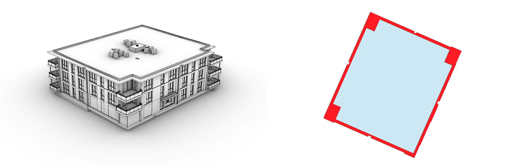 
      <figcaption>
        <a class="self-link" href="#Verschil-tussen-roofedge-BAGvorm"></a>
        <span class="fig-title">
        Het verschil tussen de BAG-polygoon en een dakuitlijn is goed zichtbaar bij een gebouw met balkons. Het gebouw (links) heeft een BAG-polygoon (rechts in grijs) die kleiner is en een andere vorm heeft dan de dakuitlijn (rechts in rood). Als de regels voor het opstellen van een BAG-vorm worden gevolgd, zoals bij de BAG-output van de IfcEnvelopeExtractor, ontstaat er echter een andere polygoon (rechts in blauw) dan de daadwerkelijke BAG-vorm van de 2DBAG-database (rechts in grijs). Dit voorbeeld BIM-model is gebruikt voor <a href="https://www.digigo.nu/ils-voor-ruimten/">ILS voor ruimten in de omgevingswet</a> gemaakt door de gemeente Rotterdam en Kuiper Compagnons.
        </span>
      </figcaption>
</figure>

In Nederland wordt voor 3D-gebouwreconstructie veelal gebruik gemaakt van de 2DBAG als extrusiebron voor LoD1.x- en 2.x-groepen, zoals bij het [3DBAG](https://www.3dbag.nl). Eerder beschreef de website van het 3DBAG de 2DBAG-brongeometrie als volgt: “De polygonen in de BAG representeren de omlijning van panden als de projectie van bovenaf (inclusief ondergrondse delen).”. Dit is conform de BAG-specificaties, maar zonder de bovenstaande uitzonderingen. Hierdoor was het niet duidelijk dat de gebruikte extrusiebron (de 2DBAG) niet de dakuitlijn representeert, maar de projectie van bovenaf met de genoemde uitsluitingen. Op de 3DBAG-website is deze [beschrijving voor de BAG-polygoon](https://docs.3dbag.nl/nl/overview/sources/) aangevuld om dit te verduidelijken.

De term "voetafdruk/footprint" heeft een vergelijkbaar probleem in gebruik. Het wordt soms gebruikt voor een polygoon die een horizontale doorsnede op een bepaalde hoogte (vaak maaiveldhoogte) door het gehele bouwwerk representeert. Maar de voetafdrukpolygoon kan ook een vorm zijn die aan strengere eisen voldoet, zoals een BGT-polygoon.

De BGT bevat de zogenaamde voetafdruk- of maaiveldgeometrie, dat wil zeggen de begrenzing van een pand daar waar het de grond raakt. In veel gevallen valt de BGT-geometrie samen met de BAG-geometrie. Een uitzondering is bijvoorbeeld een gebouw op 'palen'. In de BGT wordt de voetafdruk van deze kolommen opgenomen als deze voldoen aan bepaalde voorwaarden. De eisen van BAG-geometrie in relatie tot de BGT-geometrie staan beschreven in het [IMGEO-objectenhandboek](https://geonovum.github.io/IMGeo-objectenhandboek/pand).
Het is belangrijk om deze eisen aan de 2D-geometrie te begrijpen om ook te begrijpen wat de impact is op de extrusie als de BAG (of BGT) als extrusiebron wordt gebruikt.

Op het faculteitsterrein van de TU Delft staan twee gebouwen die de impact van de extrusiebron op de te reconstrueren geometrie duidelijk maken, gebruikmakend van de BAG als extrusiebron.

<figure id="Voorbeeld-verschil-bronoppervlak-extrusie-3DBAG" style="display: block; text-align: center; margin: 0 auto;">
      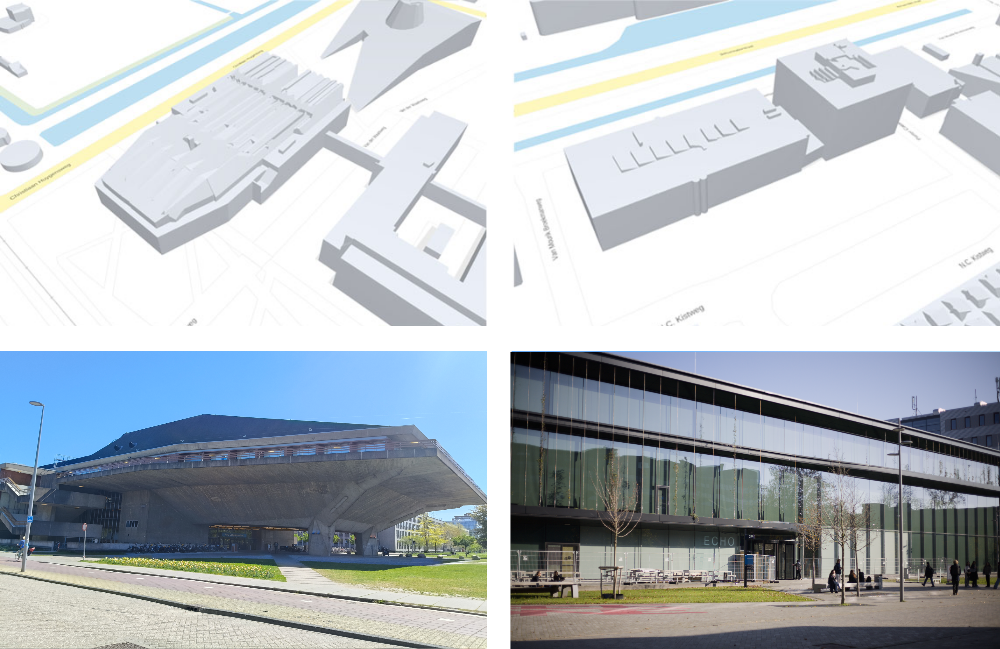 
      <figcaption>
        <a class="self-link" href="#Voorbeeld-verschil-bronoppervlak-extrusie-3DBAG"></a>
        <span class="fig-title">
        Voorbeeld van het gebruik van 2DBAG als bronoppervlaktes voor de extrusie, zoals gedaan wordt in de 3DBAG. Links in de figuur is de aula van de TU Delft gevisualiseerd. De BAG-polygoon (de geprojecteerde buitenomtrek) omvat de overhang van dit gebouw, omdat deze overhang een bouwvolume betreft. Rechts is gebouw Echo. De luifels van dit gebouw zijn wel deel van de volledige dakomtrek, maar niet van de 2DBAG-polygoon (omdat de dakoverstekken geen bouwelementen bevatten die onderdeel zijn van een bouwvolume). De draaideuren van de entree die onder deze luifels staan zijn, volgens de BAG-eisen, wel onderdeel van de 2DBAG-geometrie en daardoor ook de basis voor de extrusie in 3DBAG. Dit geeft mogelijk, incorrect, de indruk dat de voetafdruk of de BGT-polygoon als bron is gebruikt voor deze extrusie. De specificaties van de 2D-extrusiebron zijn daarom belangrijk om de verschillen in de 3D-reconstructie te begrijpen.
        </span>
      </figcaption>
</figure>

NB1: Uit de definitie van de 2DBAG-geometrie volgt ook dat ondergrondse onderdelen worden meegenomen in de 2D-geometrie zoals ondergrondse parkeergarages. Bij de 3DBAG-reconstructie worden deze panddelen uit de geometrie gefilterd op basis van de hoogtedata van het maaiveld op deze locaties.  

NB2: Voor de 3DBAG is gekozen voor 2DBAG als extrusiebron en niet BGT, omdat 2DBAG, net als AHN, een soort van bovenaanzicht geeft van de panden. Daarom passen beide databronnen goed op elkaar, zeker daar waar het gaat om gebouwen met kolommen en onderdoorgangen. In 2026 loopt een onderzoek om onderdoorgangen te modelleren in 3DBAG door deze te detecteren op basis van een BGT-BAG-analyse en de hoogte vervolgens te detecteren in oblieke luchtfoto's en LiDAR op straatniveau. De resultaten hiervan implementeert men in de 2026 release van de 3DBAG. Zie [[PETERS2026]].

<aside class="note" title="Maak aanvullende afspraken rondom voetafdruk of dakomtrek">
  <p><strong>AANBEVELING:</strong> Maak duidelijke afspraken rondom het gebruik van voetafdruk, dakomtrek, BAG-polygoon, BGT-polygoon of andere bronpolygoon voor BIM-naar-Geo-conversie en gebruik dit consistent in implementaties. Maak kenbaar welk oppervlak als extrusiebron gebruikt wordt. Maak duidelijk of de BAG-polygoon (bovenaanzicht) of BGT-polygoon (voetafdruk), of een andere geometrie als extrusiebron is gebruikt.</p>
</aside>

<aside class="note" title="Vastgestelde transformatieprofielen voor BIM-naar-Geo per toepassing">
  <p><strong>AANBEVELING:</strong> Stel transformatieprofielen op, "Inwinregels BIM", voor elke officiële gestandaardiseerde keten waarin BIM als bron voor Geo-data wordt gebruikt. Dit profiel beschrijft de eisen en regels voor de vertaling van BIM-naar-Geo en omvat minimaal een eenduidige LOD-definitie, een ILS/informatie-eis, een object- en attribuutmapping, geometrische en semantische transformaties/generalisatieregels en validatiecriteria. Het profiel vormt daarmee de gestandaardiseerde brug tussen BIM-data en de eisen van de betreffende Geo-inwinningstraat. </p>
</aside>


# Bestandsformaten

Wanneer men een conversie wil doen van open BIM naar open Geo kan men van verschillende bestandsformaten gebruik maken. Hieronder zijn een aantal belangrijke bestandsformaten beschreven voor het converteren van open BIM naar open Geo.

## CityGML XML & CityGML CityJSON

CityGML is een open conceptueel datamodel voor het opslaan van 3D-geodata. CityGML definieert verschillende objecten (classes) en hun relaties voor de meest relevante topografische objecten zoals gebruikt in stedelijke en regionale modellen. In tegenstelling tot meshbestandstypen zoals OBJ en STL maakt CityGML het mogelijk om ook attributen voor ieder object op te slaan.

Naast een datamodel is CityGML ook een data-encoding. De gelijke benaming van het datamodel en data-encoding kan tot verwarring leiden. Voor het conceptuele datamodel CityGML, is zowel een GML-, JSON- als RDF-encoding beschikbaar.

De GML-encoding is gebaseerd op een XML-datamodel. XML is een vrij omvangrijk formaat dat ook lastig te lezen is door gebruikers. Een alternatief is [CityJSON](https://3d.bk.tudelft.nl/opendata/cityjson/3dcities/v2.0/DenHaag_01.city.json), een encoding gebaseerd op een JSON-datamodel. Deze encoding is lichter dan XML en ook makkelijker door gebruikers te begrijpen. Een CityGML-bestand in de XML-encoding is gemiddeld ongeveer 7 keer zwaarder dan een CityGML-bestand in de CityJSON-encoding (zie tabel hieronder en zie [CityJSON bestandsgrootte](https://www.cityjson.org/filesize/) voor meer informatie). CityJSON kent echter ook beperkingen. Zo is niet het gehele CityGML-datamodel in de CityJSON-encoding beschikbaar.

Er is software beschikbaar die CityGML-bestanden van de ene naar de andere encoding kan omzetten, waardoor afhankelijk van de toepassing de ene of de andere encoding kan worden gebruikt.

| dataset | CityJSON v2.0 | CityGML-XML v3.0 | textures | factor kleiner |
|-|-|-|-|-|
| 3DBAG      | 7.0MB | 40MB    | none | **5.7X**   |
| Den Haag   | 2.7MB | 19MB    | none | **7.0X**   |
| Ingolstadt | 4.8MB | 40MB    | none | **8.3X**   |
| Montréal   | 5.6MB | 53MB   | none | **9.5X**   |
| New York   | 110MB | 682MB  | none | **6X**     |
| Railway    | 4.5MB | 39MB   | ZIP | **8.7X**   |
| Rotterdam  | 2.7MB | 18MB   | ZIP  | **6.7X**   |
| Vienna     | 5.6MB | 40MB   | ZIP  | **7.1X**   |
| Zürich     | 293MB | 2100MB | none  | **7X**     |

In de onderstaande codefragmenten kan de [XML](https://3d.bk.tudelft.nl/opendata/cityjson/3dcities/citygml/DenHaag_01.xml) (boven) en [CityJSON](https://3d.bk.tudelft.nl/opendata/cityjson/3dcities/v2.0/DenHaag_01.city.json) (onder) encoding van CityGML vergeleken worden. Deze twee fragmenten laten de definitie zien van hetzelfde object met een aantal attributen. De geometrie is verwijderd uit de fragmenten. Het is duidelijk te zien dat de XML-encoding veel meer karakters nodig heeft om dezelfde informatie te modelleren. Dit draagt bij aan de extra bestandsgrootte.

```xml
<cityObjectMember>
	<bldg:Building gml:id="GUID_DBDABF53-7DD5-4C2F-BE7F-51F29A0CBA16">
		<gml:name>{DBDABF53-7DD5-4C2F-BE7F-51F29A0CBA16}</gml:name>
		<bldg:consistsOfBuildingPart>
	<bldg:BuildingPart gml:id="GUID_DBDABF53-7DD5-4C2F-BE7F-51F29A0CBA16_1">
		<gml:name>{DBDABF53-7DD5-4C2F-BE7F-51F29A0CBA16}</gml:name>
		<gen:doubleAttribute name="RelativeEavesHeight"><gen:value>3.133</gen:value></gen:doubleAttribute>
		<gen:doubleAttribute name="AbsoluteEavesHeight"><gen:value>7.717</gen:value></gen:doubleAttribute>
		<gen:doubleAttribute name="RelativeRidgeHeight"><gen:value>3.133</gen:value></gen:doubleAttribute>
		<gen:doubleAttribute name="AbsoluteRidgeHeight"><gen:value>7.717</gen:value></gen:doubleAttribute>

            ...

    </bldg:BuildingPart>
  </bldg:Building>
</cityObjectMember>
```

```json
{
"GUID_DBDABF53-7DD5-4C2F-BE7F-51F29A0CBA16_1": {
    "type": "BuildingPart",
    "attributes": {
        "roofType": "1000",
        "RelativeEavesHeight": 3.133,
        "RelativeRidgeHeight": 3.133,
        "AbsoluteEavesHeight": 7.717,
        "AbsoluteRidgeHeight": 7.717
    },
    ...
  }
  ...  
}
```

Meer informatie over CityGML is te vinden in de standaard [[CITYGML30]] en op de [OGC-website](https://www.ogc.org/standards/citygml/). OGC heeft het datamodel voor de GML/XML-encoding ontwikkeld. De CityJSON-encoding is ontwikkeld onder leiding van de TU Delft en is later door OGC vastgesteld als OGC-communitystandaard. Meer over CityJSON is te vinden in de specificatie [[CITYJSON20]] en op de [CityJSON-website](https://www.cityjson.org/).

## GeoJSON

GeoJSON is een open uitwisselformaat voor geografische gegevens. Het is, net zoals CityGML CityJSON, gebaseerd op de JSON-encoding. De manier waarop de data is opgeslagen is echter anders. Ten opzichte van CityGML heeft GeoJSON meer beperkingen. GeoJSON-bestanden zijn daardoor wel eenvoudiger en worden door meer generieke GIS-applicaties ondersteund dan 3D-formaten zoals CityJSON.

```json
{
"type": "Feature",
    "properties": {
    "objectID": "GUID_DBDABF53-7DD5-4C2F-BE7F-51F29A0CBA16_1 Park",
    "roofType": "1000",
    "RelativeEavesHeight": 3.133,
    "RelativeRidgeHeight": 3.133,
    "AbsoluteEavesHeight": 7.717,
    "AbsoluteRidgeHeight": 7.717
    },

      ...
}
```

## IFC

De Industry Foundation Classes (IFC) zijn een set van gestandaardiseerde, digitale beschrijvingen van objecten in de gebouwde omgeving voor bouwinformatiemodellen (BIM). IFC is een open internationale standaard voor het delen van data van de gebouwde omgeving. De standaard bevat definities voor data die benodigd is voor gebouwen en infrastructurele werken over de gehele levenscyclus bezien, van ontwerp en constructie tot beheer. De standaard wordt voornamelijk gebruikt in de AEC-sector (Architecture, Engineering & Construction). IFC bestaat uit een schema, een documentatie, property (kenmerken) en quantity (hoeveelheden) sets en het mechanisme van het uitwisselformaat. IFC biedt machine-interpreteerbare informatie en maakt daarmee automatisering van workflows mogelijk. Het is net als andere open standaarden software-onafhankelijk en voor iedereen beschikbaar. Binnen het formaat is het mogelijk om gebouwen, wegen, spoor, waterwegen en havenfaciliteiten te modelleren. 

In deze praktijkrichtlijn wordt de BIM-naar-Geo-workflow beschreven voor open uitwisseling van BIM en Geo. Hiervoor baseert de praktijkrichtlijn zich voornamelijk op het IFC-uitwisselformaat voor BIM en CityGML (JSON-encoding) voor Geo. 

## 3D Tiles

Voor het grootschalig streamen en renderen van BIM-modellen is de OGC-standaard 3D Tiles [[3DTILES]] te gebruiken. Met een tileset.json kan het formaat schakelen tussen verschillende Level of Detail. Deze standaard is primair bedoeld voor visualisatie en niet voor het modelleren of analyseren van modellen. GlTF en het binary formaat daarvan, GLB, is het primaire tegelformaat voor 3D Tiles. Het is mogelijk om attribuutinformatie mee te nemen in dit bestandsformaat, die moet vanwege de snelheid van streamen en renderen zoveel mogelijk beperkt te blijven. Wanneer attributen van belang zijn, kan men beter een bestandsformaat als CityJSON kiezen. 

Voor meer informatie, zie de handreiking 3D Tiling [[3DTILING]] en zie convertors als [ifc2b3dm](https://github.com/Erfan-Shooraj/ifc2b3dm). Er zijn ook betaalde converters of add-ins [Cesium-Revit-add-in](https://cesium.com/blog/2024/12/03/cesium-design-tiler-and-revit-add-in/) die men kan gebruiken. 

