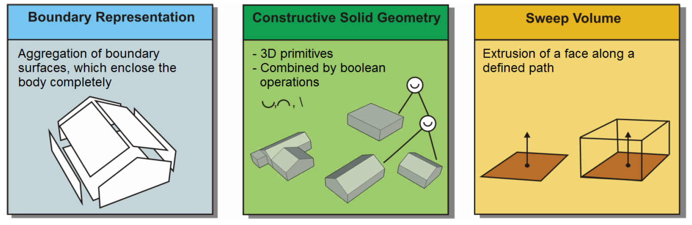
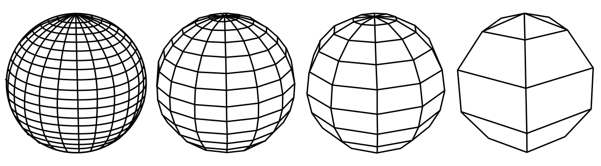
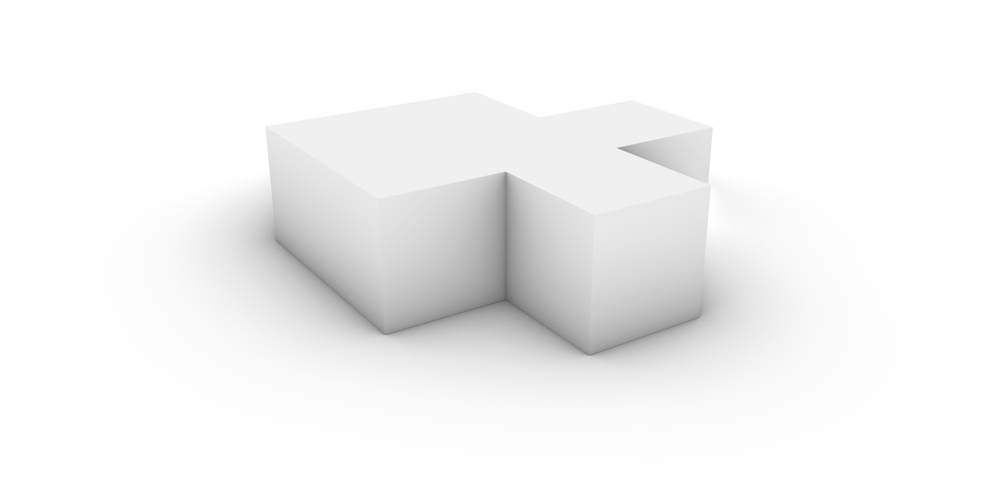
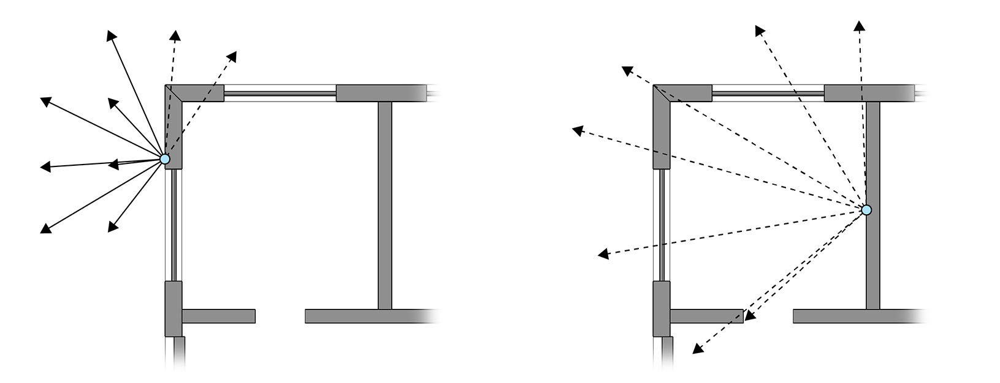
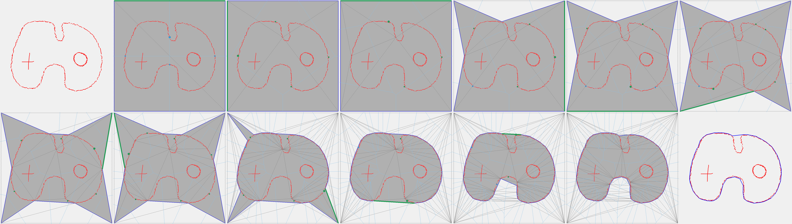
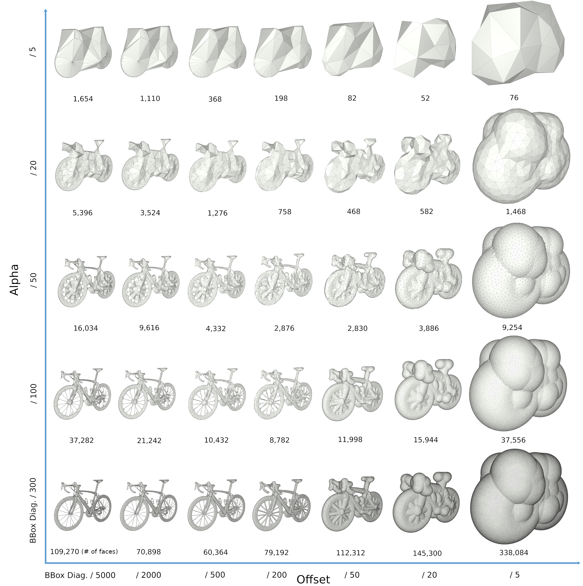

# Geometrie BIM naar Geo

## Impliciete en expliciete geometrie
Geometrie kan impliciet of expliciet zijn gedefinieerd. Expliciete geometrie is geometrie die volledig is uitgeschreven, dat wil zeggen: alle coördinaten van de vertices, edges, faces en curves. Er is geen procedure of wiskundige berekening nodig om de geometrie op te stellen. Bij impliciete geometrie is dit anders. De geometrie is beschreven als een wiskundige of procedurele definitie. Pas bij rendering of conversie wordt geometrie vertaald naar vertices, edges, faces en curves. 
In de Geo-formaten CityJSON, CityGML en GeoJSON maakt men voornamelijk gebruik van expliciete geometrie. In het open-BIM-formaat IFC kan men zowel impliciete als expliciete geometrie opslaan. Een softwaregebruiker is zich niet altijd bewust van het type geometrie dat is gemodelleerd. 
Complexe impliciete geometrie kan bij conversie naar expliciete CityJSON-geometrie een groot bestand opleveren.  

<figure id="drie_benaderingen_IFC_geometrie" style="display: block; text-align: center; margin: 0 auto;">
      
      <figcaption>
        
        
        Drie benaderingen voor geometrie in IFC   
        bron:
        <a href="https://resolver.tudelft.nl/uuid:31380219-f8e8-4c66-a2dc-548c3680bb8d" >Automatic generation of CityGML LoD3 building models from IFC-models</a> S. Donkers
        
      </figcaption>
</figure>

## Meshing
De geometrieën van het BIM-model worden vertaald naar Geo-geometrieën. Waar nodig worden IFC-geometrieën omgezet naar solids of polygonen. Dit kan op verschillende detailniveaus. Een hoger detailniveau resulteert in een nauwkeurigere representatie en vergroot de bestandsgrootte.

<figure id="Mesh_van_Geometrien_2" style="display: block; text-align: center; margin: 0 auto;">
      
    <figcaption>Meshing van dezelfde geometrie op verschillend detailniveau</figcaption>
</figure>

## Technieken voor shell-extractie
Zoals eerder beschreven is shell-extractie nu vooral beschikbaar in experimentele vorm voor het van BIM naar GIS brengen. Hierdoor zijn er nog geen standaard methodes ontwikkeld en gebruikt iedere software een eigen benadering. Dit hoofdstuk beschrijft de verschillende manieren waarop sommige schilmodellen worden gegenereerd door verschillende beschikbare software. Dit is een selectie van de processen om een complex BIM-model te converteren naar een versimpeld Geo-model.

### Voxelisatie
Een shell-extractiemethode die wordt gebruikt is voxelisatie. Voxelisatie benadert de vorm van een gebouw/bouwwerk met behulp van VOlumetrische piXELS (voxels). De resulterende vorm kan worden gezien als een blokkendoosrepresentatie van het inputmodel. Dit is op dit moment geen standaard GIS-vorm die wordt beschreven in bestaande LoD-frameworks. Een Geo-model dat is gegenereerd als voxelisatie van een BIM-model kan echter heel waardevol zijn. Voxelisatie kan namelijk aspecten van een gebouw opslaan die verder alleen in hele complexe LoD-modellen beschikbaar zijn (LoD3+), zoals overhang (dakoverstek) en gevelopeningen. Voxelistatie is minder precies dan deze LoD3+-modellen maar het resulterende model is wel een stuk robuuster en sneller. Daar waar een LoD3+-vorm niet gemaakt kan worden door een schilextractor vanwege onvoldoende kwaliteit of een te grote complexiteit van het inputmodel kan mogelijk een voxelistatie wel gemaakt worden.

Voxelisatie komt met specifieke problemen waarvoor nog geen goede oplossingen zijn. Zo is de vorm van het gevoxeliseerde model afhankelijk van de voxelgrootte en de rotatie van het grid dat gebruikt werd tijdens de voxelisatie.

[Van der Vaart et al.](https://isprs-annals.copernicus.org/articles/X-4-W5-2024/297/2024/) beschrijven het effect van verschillende voxelgrootte op het volume en oppervlakte van een externe schilrepresentatie van een IFC-model. Hieruit blijkt dat de oppervlakte van de voetafdruk, het volume van de gehele schil en de visuele representatie beter worden benaderd met kleinere voxels. Als de voxelgrootte correct wordt gekozen, is het voxel-gebaseerde model ook preciezer op deze aspecten dan de LoD2.2-representaties.

Op basis van de grootte van een model wordt een "ideale" voxelgrootte gepresenteerd door [Van der Vaart et. all](https://isprs-annals.copernicus.org/articles/X-4-W5-2024/297/2024/). Deze waardes zijn mogelijk al verouderd, zo zijn elementen zoals bestandsgrootte niet meegenomen en ook is het onderzoek gedaan met een oude versie van de [IfcEnvelopeExtractor](https://github.com/tudelft3d/IFC_BuildingEnvExtractor). Sinds dit onderzoek is de voxelisatiecode versneld en zijn de rekentijden uit het onderzoek niet meer representatief. 

<figure>
  
  <figcaption>Animatie die het effect op de resulterende voxelschil laat zien bij verfijning van de gekozen voxelgrootte. De grootte gaat van 21,78 m naar 0,09 m door bij iedere stap de voxelgrootte door twee te delen. Het inputmodel is het Schependomlaan model.</figcaption>
</figure>

<!-- rotatie -->

### Schil met hoge resolutie
Een schil met hoge resolutie kan op verschillende manieren worden gemaakt. De meest gebruikte technieken zijn ray-casting en alpha shapes.

#### Ray casting

Ray-casting is een proces waarbij rechte lijnen (rays) worden gebruikt om te testen of een polygoon deel uitmaakt van de buitenschil van een gebouw. Het resultaat van een ray-castingproces is echter niet direct een correct gesloten buitenschil. Na een ray-castingproces is extra correctie nodig om een gesloten buitenschil te maken van de geselecteerde elementen. Zo kunnen de resulterende polygonen maar gedeeltelijk deel uitmaken van de buitenschil of kleine openingen bevatten.

De eerste stap van een ray-castingproces is puntenpopulatie. In de meest simpele vorm van ray-casting worden alle polygonen van een model bedekt met punten. Vanaf deze punten worden één of meer lijnen getrokken in de globale normaalrichting van de polygoon. Voor iedere lijn wordt er getest of de lijn met andere polygonen van het model gesneden wordt. Als een lijn niet wordt gesneden dan is het punt "zichtbaar" vanaf de buitenkant van het gebouw, en dus maakt de polygoon waar dit punt op rust deel uit van de buitenschil. Als alle lijnen uit alle punten op een polygoon worden gesneden kan dus de aanname worden gedaan dat deze polygoon geen rol speelt bij het modelleren van de buitenschil. Deze polygoon kan dus worden verwaarloosd.

De polygonen die gevonden worden bij ray-casting spelen een rol bij het modelleren van de buitenschil. Maar deze kunnen mogelijk gedeeltelijk deel van de buitenschil en deel van het interieur zijn. Aanvullend kunnen er kleine gaten tussen polygonen aanwezig zijn in het BIM-model. Deze kleine gaten worden mee overgenomen en moeten op een manier gesloten worden voordat een gesloten buitenschil kan worden gemaakt.

De beschreven manier van ray-casting is erg simpel, maar ook relatief zwaar en traag. Er zijn veel optimalisaties om dit proces te versnellen. Een correct gemodelleerd BIM-model maakt gebruik van (de juiste) types/classes voor objecten. Op basis van deze types kan er al een filtering worden toegepast voorafgaand aan de ray-casting. Meubels (IfcFurniture) zullen bijvoorbeeld niet zo snel deel uitmaken van de buitenschil van een gebouw. Objecten met dit type hoeven dus niet behandeld te worden door het ray-castingproces, maar kunnen direct worden genegeerd. Dit versnelt het proces doordat vanaf deze objecten dus geen ray-casting hoeft te worden gedaan, maar ook omdat het voor deze objecten niet nodig is de rays van andere polygonen te snijden.

<figure id="Ray_Casting_BIM" style="display: block; text-align: center; margin: 0 auto;">
      
      <figcaption>
        
        
        Een voorbeeld van een ray-castingproces. De afbeelding laat twee raycastingprocessen zien in een 2D-plattegrond van een kamer. Links is een punt zichtbaar omdat de lijnen die eruit worden getrokken niet snijden met geometrie. Rechts is het punt niet zichtbaar omdat alle lijnen die eruit worden getrokken wel snijden met geometrie.          
        
      </figcaption>
</figure>

De IfcEnvelopeExtractor gebruikt "voxel assisted ray-casting". Het gebruikt een voxelisatie om de hoeveelheid en lengte van de rays voor het raycastingproces te beperken. Dit wordt gedaan door de voxels die om een punt op een polygoon liggen te evalueren. Als er geen voxels om het punt heen liggen die geclassificeerd zijn als "external" dan kan de aanname worden gedaan dat deze polygoon geen rol speelt bij het modelleren van de buitenschil. Als er wel 'external' voxels om het punt heen liggen dan kunnen de middelpunten van deze voxels worden gebruikt als eindpunt voor de rays. Dit zorgt ervoor dat er geen onnodig lange lijnen worden getrokken waardoor de hoeveelheid berekeningen kan worden teruggedrongen.

Aanvullend kan nog voor de aanvang van het ray-castingproces een filtering van objecten worden gedaan met behulp van de voxels. Met voxels is het makkelijk om te bepalen of ze buiten of binnen het gebouw liggen, maar ook of de voxels snijden met de geometrie. De voxels die snijden met het gebouw en een buurman hebben die buiten het gebouw ligt kunnen worden gezien als een buitenschilvoxels. De geometrie van het gebouw dat snijdt met deze buitenschilvoxels kan worden geïsoleerd en worden gezien als "mogelijk" deel van de buitenschil. Door deze selectie kan ook al een deel van de interne objecten worden genegeerd. 

De kwaliteit van de resultaten van deze twee voxelondersteunde processen is erg gevoelig voor het formaat van de voxels. Als de voxels te groot zijn, kan dit resulteren in objecten die incorrect worden verwaarloosd. Als de voxels te klein zijn, vertraagt het process sterk en is het mogelijk dat de buiten- en binnenkant van het gebouw niet correct worden gedetecteerd.

#### Alpha shapes

Alpha shapes of Alpha wrapping is een proces waarbij polygonen worden gemaakt die puntenwolken omsluiten. In het kort: dit wordt gedaan door stapsgewijs een gesloten primitieve vorm (vaak een bal in 3D of een cirkel in 2D) te gebruiken om een polygoon (de alpha shape) bij te snijden totdat deze de puntenwolk strak omhult. De primitieve vorm kan alleen delen van de polygoon wegsnijden als er geen punten in de vorm liggen.

<figure id="Alpha_Wrap_Principle" style="display: block; text-align: center; margin: 0 auto;">
      
      <figcaption>
        
        
        Principe van Alpha Wrapping   
        bron:
        <a href="https://cgal.github.io/cgal-web/2022/05/18/alpha_wrap/" >CGAL: 3D Alpha Wrapping</a> 
        
      </figcaption>
</figure>

Afhankelijk van de gekozen primitieve vorm en het formaat is de resulterende alpha shape anders.

<figure id="Alpha_Wrap_Bike" style="display: block; text-align: center; margin: 0 auto;">
      
      <figcaption>
        
        
        Verschillende vormen, alpha shapes, die resultaat zijn van een alpha wrapping methode   
        bron:
        <a href="https://cgal.github.io/cgal-web/2022/05/18/alpha_wrap/" >CGAL: 3D Alpha Wrapping</a> 
        
      </figcaption>
</figure>

Omdat het alpha-shapeproces enkel werkt met puntenwolken, moet de BIM-geometrie omgezet worden naar een puntenwolk. Dit kan worden gedaan op een vergelijkbare manier als bij de ray-castingprocessen.

De resulterende vorm van de alpha shape is altijd een gesloten object. Dit is een "correct" schilmodel, maar wel een benadering van de buitenschil. De alpha shape is bijna altijd anders dan de BIM-brongeometrie. De alpha shape is een mesh met hoge resolutie die vooral in concave hoeken zal afwijken van de buitenschil van het input-BIM-model.

<aside class="note" title="Plaats voor alpha shape in GIS">
  
<strong>AANBEVELING:</strong> Onderzoek de bruikbaarheid en wenselijkheid van alpha shapes in GIS. Als alpha shapes bruikbaar worden bevonden moet de inpassing in een LoD-framework worden onderzocht. 

</aside>

De afwijking in de concave hoeken komt omdat de primitieve vorm die wordt gebruikt om de alpha shape bij te snijden niet diep in de concave hoeken past. Deze afwijking kan in beperkte mate worden gecorrigeerd door de primitief die wordt gebruikt kleiner te maken. Een te kleine primitief zorgt echter voor een trager en minder robuust proces. Aanvullend heeft een kleinere primitief ook een puntenwolk met hogere resolutie nodig. Als de diameter van de primitief kleiner is dan de afstand tussen 2 punten op een polygoon van het BIM-model dan zal deze polygoon niet correct gerepresenteerd worden in de output.

[Wang et al.](https://doi.org/10.1080/17538947.2024.2368708) laten zien dat de alpha shape op zichzelf niet het resultaat hoeft te zijn van de shell-extractie maar ook als een tussenstap kan worden gebruikt. Bij dit onderzoek gebruiken ze de alpha shape om de polygonen die deel zijn van de buitenschil van het BIM-model te vinden. Dit wordt gedaan door te testen welke polygonen van het BIM-model het dichtst bij het zwaartepunt van iedere driehoek van de alpha-shapemesh liggen. 

Deze groep van polygonen heeft echter hetzelfde probleem als de groep van polygonen die worden gevonden bij het ray-castingproces. De groep moet worden gecorrigeerd voordat een gesloten buitenschil kan worden gemaakt. 

### Keuze van een techniek

De technieken sluiten elkaar niet uit en worden in de praktijk vaak gecombineerd. Voxelisatie is robuust en werkt ook bij minder goed gemodelleerde BIM-modellen, maar is minder precies. Raycasting sluit nauwkeurig aan op de BIM-geometrie, maar vraagt een correctiestap om tot een gesloten schil te komen. Alpha wrapping levert altijd een gesloten schil op, maar benadert de vorm en wijkt af in concave hoeken. De [IfcEnvelopeExtractor](#workflow-ifcenvelopeextractor) combineert bijvoorbeeld voxelisatie en raycasting.