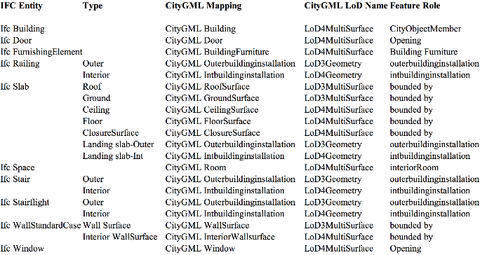
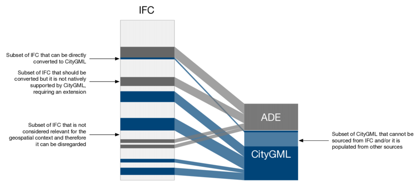
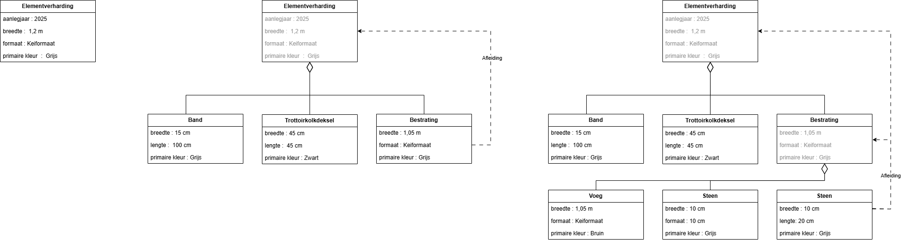
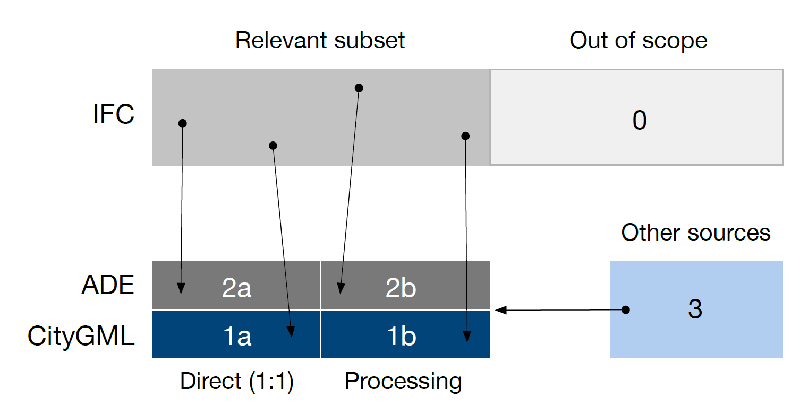
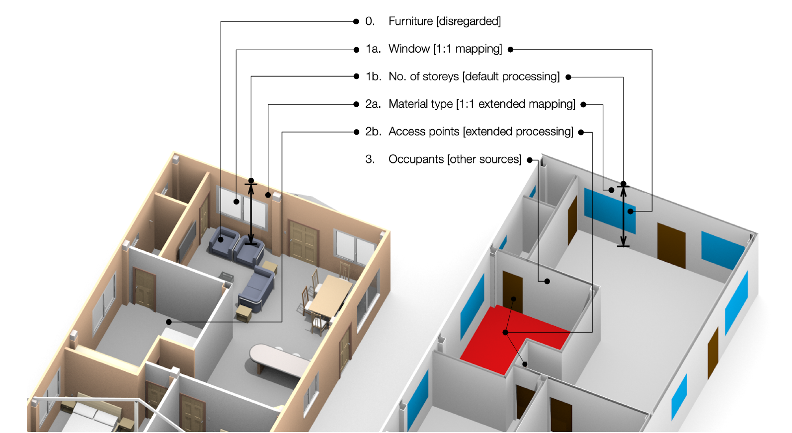
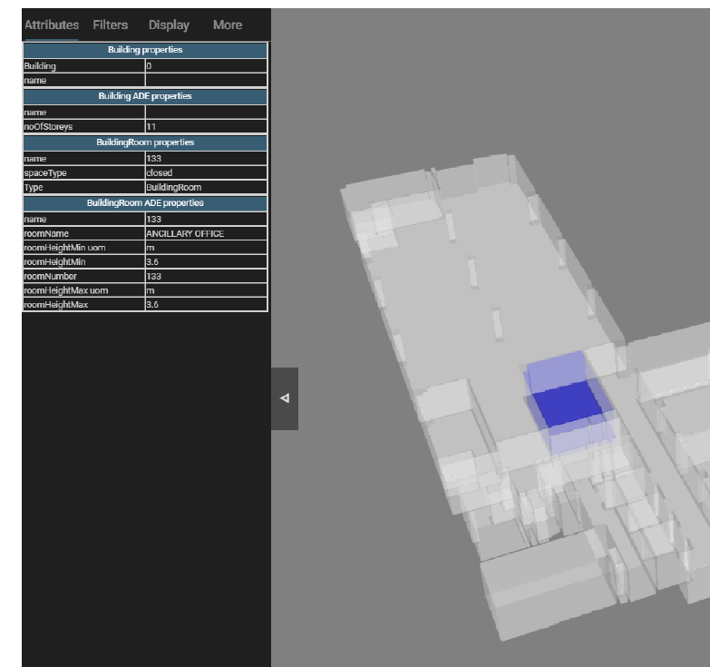

# Entiteit en Attribuut BIM naar Geo

Voor het transformeren van BIM- naar Geo-informatie is het mappen van entiteiten en attributen van belang. Waar geometrie vooral de vorm en locatie van een ding vastlegt, beschrijft de entiteit wat het ding is en bevatten attributen gegevens over eigenschappen zoals materiaal, functie, voorkomen, afmeting of classificatie. Bij de transformatie van BIM naar Geo moeten naast geometrie ook deze entiteiten en attributen correct worden vertaald tussen standaarden. Omdat BIM- en Geo-standaarden verschillen in datastructuur, detailniveaus en semantische definities, is dit een uitdaging. 

## Entiteitmapping 
Er zijn verschillende entiteitmappingen van IFC naar CityGML/CityJSON ontwikkeld ter ondersteuning van de conversie tussen BIM en Geo. Een vroeg voorbeeld is de masterthesis [Automatic generation of CityGML LoD3 building models from IFC models](https://repository.tudelft.nl/record/uuid:31380219-f8e8-4c66-a2dc-548c3680bb8d) van Sjors Donkers (TU Delft, 2013). Daarnaast heeft de National University of Singapore een [ifc2citygml](https://ifc2citygml.github.io/)-mapping (2019) gemaakt. Ook de Technische Universität München (TUM) voorziet in een [mapping en converter](https://github.com/tum-gis/ifc-to-citygml3) van IFC naar CityGML 3.0. 
De Hong Kong University of Science and Technology (HKUST) heeft IFC-naar-CityGML-mappingen gepubliceerd in een [BIM/GIS](https://cejcheng.people.ust.hk/bimgis/)-omgeving, en de Nationale Technische Universiteit van Athene heeft onderstaande mapping uitgewerkt.

<figure id="Mapping_entiteiten_IFC_naar_GEO">
      
    <figcaption>Semantische mapping van IFC naar CityGML LoD4   bron: <a href="https://www.researchgate.net/figure/Semantic-mapping-from-IFC-to-CityGML-LoD-4_fig3_327604195">G. Floros et al. (2018)</a></figcaption>
</figure>

De verschillende mappingen richten zich op verschillende LoD's en/of attribuutmappingen en daarmee op verschillende aspecten van een BIM-naar-Geo-conversie. De benaderingen vullen elkaar aan en laten zien dat er geen algemeen geaccepteerde, uniforme mapping bestaat die alle aspecten van een BIM-naar-Geo-conversie afdekt.

Het is niet mogelijk om elke entiteit in IFC naar een entiteit in het basismodel van CityGML te mappen. Men zal altijd een keuze moeten maken welke entiteiten hierbij van belang zijn. Wel is het mogelijk om een of meer uitbreidingen (Application Domain Extensions, ADE's) op CityGML te maken om alle IFC-entiteiten een plek te bieden. Dit is beschreven door Biljecki et al. in [Extending CityGML for IFC-sourced 3D city models](https://doi.org/10.1016/j.autcon.2020.103440).

<figure id="IFC_naar_CityGML_en_ADE">
      
    <figcaption>IFC naar CityGML met een ADE</figcaption>
</figure>

Een voorbeeld van een ADE voor IFC-entiteiten in CityGML is weergegeven in [bijlage B](#entiteit-en-attribuutmapping-tussen-bim-en-geo).

Naast verschillende Levels of Detail (LoD's) zijn er ook verschillende decompositieniveaus die men vanuit één gedetailleerd BIM-model kan genereren. Zie [bijlage A](#mapping-tussen-ifc-en-citygml-op-verschillend-decompositieniveau).

Zoals in de [BIM basis ILS - hoofdstuk classificatie](https://www.digigo.nu/ilsen-en-richtlijnen/bim-basis-ils/3-6-classificatiesystematiek/) is aangegeven, dient men in BIM naast het juiste gebruik van entiteiten ook de juiste classificatie te gebruiken. Ook classificaties kan men mappen. Er zijn verschillende classificatiestandaarden en objectbibliotheken in BIM en Geo, zoals NL-SfB, NLCS, ETIM, NEN 2767-4 en IMBOR, en soms domeinspecifieke standaarden zoals SATO van Rijkswaterstaat voor tunnels. 

<aside class="note" title="Entiteitmapping op basis van entiteit of op basis van classificatie">
  
<strong>AANBEVELING:</strong> Maak afspraken over de manier van mappen tussen IFC en CityGML/CityJSON: mapt men op basis van entiteit, userdefined-patroon of op basis van classificatie? Leg ook vast wat leidend is wanneer classificatie, userdefined-patroon of entiteitgebruik elkaar tegenspreken.

</aside>

## Attribuutmapping
Entiteitmapping beschrijft hoe objecttypen uit een BIM-model worden gekoppeld aan objecttypen in een Geo-model. Attribuutmapping beschrijft hoe de eigenschappen van deze objecten worden vertaald en overgenomen van de attributen van het bronmodel naar die van het doelmodel.

Voor de mapping zijn verschillende opties: 

- 1-op-1-mapping 
- Procesmapping: 
  - n-op-1-mapping (aggregatie)
  - 1-op-n-mapping
  - Afgeleide of berekende attributen
  - Transformaties tussen hiërarchische niveaus
- Externe bronnen

### 1-op-1-mapping
Sommige attributen kan men direct, 1-op-1, mappen. Zo komt het attribuut "name" van een "IfcBuilding" overeen met het attribuut "naam" van een "IMBOR:Gebouw". Een schets van zo'n mapping van IFC 4.3 naar IMBOR is opgenomen in [bijlage D](#ifc-naar-imbor-mapping). Beide attributen hebben dezelfde betekenis en kunnen daarom zonder aanvullende transformatie aan elkaar worden gekoppeld. De 1-op-1-mappingen vormen vaak maar een zeer beperkt deel van een totale attribuuttransformatie. Door verschillen in doel, structuur en detailniveau tussen BIM- en Geo-informatiemodellen moeten veel attributen worden afgeleid, geaggregeerd of via aanvullende transformatieregels worden bepaald.

### Procesmapping
Bij een procesmapping is een bewerking nodig om de waarde van een attribuut in het doelmodel te bepalen. Hieronder staan de meest voorkomende vormen.

#### n-op-1-mapping (aggregatie)
Meerdere attributen in het bronmodel worden samengevoegd tot één attribuut in het doelmodel. Een bronmodel kent bijvoorbeeld de attributen "lengte", "breedte" en "hoogte", terwijl het doelmodel (IMBOR) één attribuut "afmetingen" (l × b × h) kent.
Een ander voorbeeld zijn de attributen "straat", "huisnummer" en "postcode", die in een ander model samen het attribuut "adres" vormen. 

#### 1-op-n-mapping
Eén attribuut in het bronmodel wordt verdeeld over meerdere attributen in het doelmodel. Een object met objecttype "fietspad rood asfalt" in BIM wordt in CityGML bijvoorbeeld een object met als attribuut functie = "fietspad" en als attribuut type verharding = "asfalt". 
Zo kan ook de naam "Bank type B12 groen" in IMBOR worden opgesplitst in objecttype = "Bank", typeaanduiding = "B12" en kleur = "groen". 
Ook de NLCS-naam, die meerdere kenmerken in één naam combineert, is hiervan een goed voorbeeld. 

#### Afgeleide of berekende attributen
De waarde van een attribuut in het doelmodel wordt berekend uit gegevens in het bronmodel. Zo kan de gebouwhoogte worden berekend uit de bouwlagen (IfcBuildingStorey) en de geometrie van het BIM-model. 
Uit de inhoud van de netto ruimten en de bouwdelen (products) kan de bruto inhoud (conform NEN2580) worden bepaald. Op vergelijkbare wijze kan de bruto vloeroppervlakte (BVO) (conform NEN2580) worden berekend. 

#### Transformaties tussen hiërarchische niveaus
Zowel in Geo- als in BIM-informatiemodellen komen verschillende decompositieniveaus voor. Attributen van objecten op een hoger decompositieniveau kunnen worden afgeleid of geaggregeerd uit objecten op een lager decompositieniveau. Daarbij is vaak sprake van een specifieke relatie tussen een attribuut van een samengesteld object en een attribuut van één of meerdere onderliggende objecttypen waaruit dat object is opgebouwd.

Zo kan een objecttype "elementverharding" op een lager decompositieniveau bestaan uit een band, trottoirkolkdeksels en bestrating. Het attribuut "formaat" op het hogere decompositieniveau betreft het formaat van de stenen of tegels in het bestratingsvlak, niet het formaat van de band of de trottoirkolk die ook deel uitmaken van de elementverharding. Het formaat kan dus alleen worden afgeleid uit de hele stenen waaruit het bestratingsvlak op het lagere decompositieniveau bestaat. 

Daarom zijn expliciete afleidings- of aggregatieregels nodig, waarin wordt vastgelegd van welk onderliggend objecttype en attribuut de waarde op een hoger decompositieniveau wordt afgeleid.

<figure id="Afleiding_van_attribuut">
      
    <figcaption>Afleiding van attribuut</figcaption>
</figure>

### Externe bronnen
Bij een conversie van IFC naar CityGML is het niet altijd mogelijk om alle benodigde informatie uitsluitend uit het IFC-model af te leiden. Externe bronnen kunnen onder meer worden ingezet voor het aanvullen van ontbrekende attributen, het bepalen van classificaties, het afleiden van functies of het verrijken van objecten met contextinformatie. Voorbeelden hiervan zijn basisregistraties (zoals adressen- en gebouwenregistraties), topografische datasets en hoogtebestanden.

## Combinatie van mappingroutes
Een volledige entiteit- en attribuutmapping van BIM naar Geo is in de praktijk een combinatie van de hierboven beschreven opties, zoals beschreven in [Extending CityGML for IFC-sourced 3D city models](https://doi.org/10.1016/j.autcon.2020.103440). 

<figure id="Routes_attribuut_mapping_1">
      
    <figcaption>Routes van attribuutmapping</figcaption>
</figure>

In deze figuur staat "0" voor de informatie die niet van BIM naar Geo hoeft te gaan. Het getal "1" staat voor aanwezig in CityGML en "2" voor een aanvulling op CityGML in de vorm van een ADE. Het getal "3" staat voor de externe bronnen die kunnen ondersteunen bij het genereren van CityGML. De letter "a" staat voor de directe 1-op-1-mappingen en "b" voor de procesmappingen. 

Onderstaand voorbeeld laat zien hoe al deze routes binnen één conversie van BIM naar Geo worden gebruikt. *Meubels* worden buiten beschouwing gelaten voor de conversie ("0"). Voor de entiteit *raam* bestaat een 1-op-1-mapping naar CityGML ("1a"). Het *aantal verdiepingen* kan worden berekend en in CityGML worden vertaald ("1b"). Het materiaaltype van een object kan een 1-op-1-mapping naar een CityGML-ADE zijn ("2a"); het aantal toegangspunten van een ruimte kan een procesmapping naar een ADE zijn ("2b"). Ten slotte is het aantal bewoners alleen vanuit externe bronnen ("3") toe te voegen.

<figure id="Routes_attribuut_mapping_2">
      
    <figcaption>Voorbeeld van routes van attribuutmapping binnen één conversie</figcaption>
</figure>

Hieronder is een voorbeeldresultaat van bovenstaande attribuutmapping weergegeven. Een aantal attributen op gebouwniveau maakt deel uit van het basismodel van CityGML. Aanvullende ADE-properties geven na de mapping meer informatie over dit gebouw.  

<figure id="Routes_attribuut_mapping_3">
      
    <figcaption>Voorbeeldresultaat van attribuutmapping met CityGML- en ADE-attributen</figcaption>
</figure>
