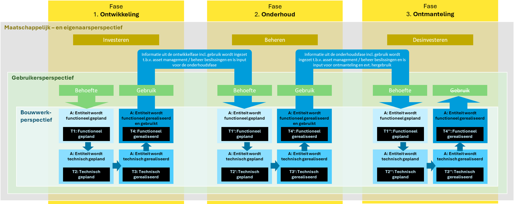
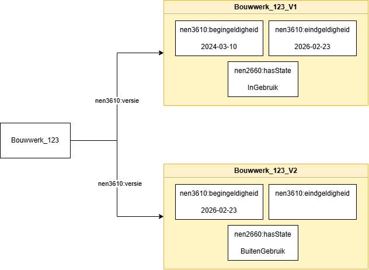
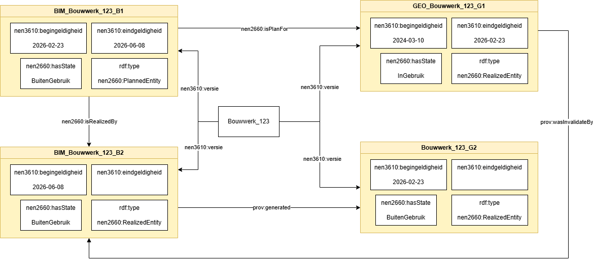
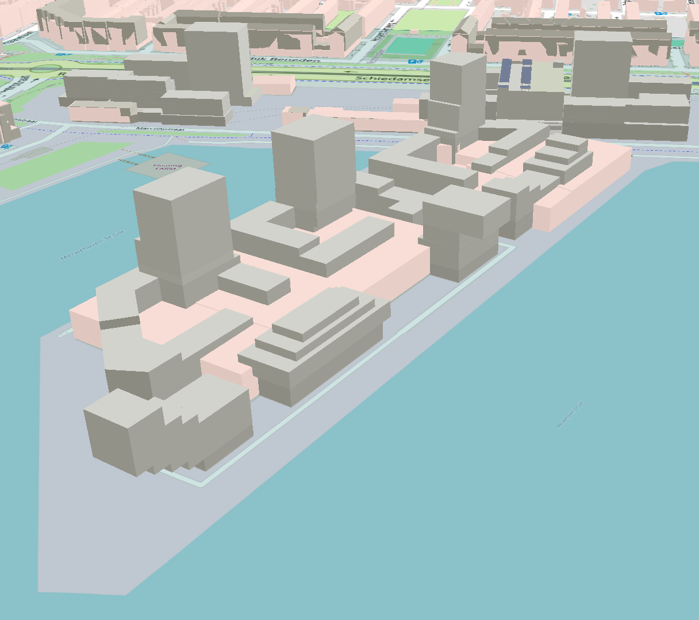

# Levenscyclus van BIM naar Geo

## Levenscyclus volgen GEBORA
Geo- en BIM-objecten kunnen hetzelfde fysieke bouwwerk beschrijven, maar vanuit verschillende perspectieven en detailniveaus. Gedurende de gehele levenscyclus van een bouwwerk, van ontwerp en realisatie tot beheer, renovatie en sloop, staan deze objecten met elkaar in relatie. Wijzigingen in BIM-objecten, zoals aanpassingen aan afmetingen, functies of constructieve elementen, hebben gevolgen voor de Geo-objecten. Een consistente koppeling tussen Geo- en BIM-data is daarom essentieel om informatie gedurende de levenscyclus van een object actueel en betrouwbaar te houden.

De Gebouwde Omgeving Referentie Architectuur (GEBORA) bestaat uit verschillende onderdelen, zie [GEBORA-onderdelen](https://www.digigo.nu/gebora-onderdelen/). Een van deze onderdelen is de [GEBORA Bouwwerk Levenscyclus](https://www.digigo.nu/gebora-bouwwerk-levenscyclus/). 

<figure id="Gebora_levenscyclus">
      
    <figcaption>GEBORA Bouwwerk Levenscyclus</figcaption>
</figure>

Wanneer een functionele behoefte bestaat (bijvoorbeeld men wil wonen) dan wordt er een technische uitwerking gemaakt van een object dat voorziet in de functionele behoefte. Er wordt bijvoorbeeld een woning ontworpen. De technische entiteit werkt men vaak uit in BIM. Na verschillende ontwerp-iteraties realiseert men de entiteit en voorziet het, bij goed ontwerp, in de functionele behoefte. 

## Maatregel en status
Een entiteit kan een maatregel en een status van deze maatregel meekrijgen. Op basis van deze maatregel en status kan de BIM-naar-Geo conversie tot verschillende acties leiden. 

### Maatregel
In BIM definieert men een maatregel die men uit kan voeren op een entiteit. Dit kan volgens de [GWSW-maatregelontologie](https://data.gwsw.nl/maatregelen/) een van de volgende maatregelen zijn:

- Aanleggen
- Buiten gebruik stellen
- Conserveren
- Onderhouden
- Onderzoeken
- Renoveren
- Repareren
- Vervangen
- Verwijderen

### Status maatregel
Een maatregel heeft daarnaast een status. Deze status kan zijn: 
- Gepland
- In uitvoering
- In voorbereiding
- Uitgevoerd 
- Vervallen 

Zowel de maatregel als de status maatregel zijn nodig om te weten op welke manier men een entiteit van BIM naar Geo moet brengen. 

### Status functioneren
Naast de status van de maatregel kent een bouwwerk een *status functioneren*. Deze beschrijft in welke fase van de levenscyclus het bouwwerk zelf zich bevindt, los van de werkzaamheden die eraan worden uitgevoerd. De status functioneren kan zijn:

- In ontwerp (ONT)
- In aanleg
- In gebruik (ACT)
- Buiten gebruik

De maatregel hoort bij het BIM-object. Het Geo-object neemt de maatregel en de status maatregel alleen over in een planversie, zolang de maatregel nog niet is uitgevoerd. De status functioneren van het Geo-object volgt die van het BIM-object pas wanneer de status maatregel **Uitgevoerd** is. Tot dat moment blijft in de Geo-omgeving de bestaande situatie geldig.

### Van BIM-object naar Geo-object
Onderstaande tabel laat voor een bouwwerk zien welke maatregel, status maatregel en status functioneren het BIM-object en het Geo-object hebben, en hoe de Geo-omgeving reageert op het BIM-object.

<table>
  <thead>
    <tr>
      <th rowspan="2">Situatie</th>
      <th colspan="3">BIM-object</th>
      <th colspan="3">Geo-object</th>
      <th rowspan="2">Reactie in de Geo-omgeving</th>
    </tr>
    <tr>
      <th>Maatregel</th>
      <th>Status maatregel</th>
      <th>Status functioneren</th>
      <th>Maatregel</th>
      <th>Status maatregel</th>
      <th>Status functioneren</th>
    </tr>
  </thead>
  <tbody>
    <tr>
      <td>Aanleg in ontwerp</td>
      <td>Aanleggen</td>
      <td>Gepland of In voorbereiding</td>
      <td>In ontwerp (ONT)</td>
      <td>Aanleggen¹</td>
      <td>Gepland of In voorbereiding¹</td>
      <td>In ontwerp (ONT)¹</td>
      <td>Planversie maken¹, anders geen actie</td>
    </tr>
    <tr>
      <td>Aanleg in uitvoering</td>
      <td>Aanleggen</td>
      <td>In uitvoering</td>
      <td>In aanleg</td>
      <td>Aanleggen¹</td>
      <td>In uitvoering¹</td>
      <td>In aanleg¹</td>
      <td>Planversie bijwerken¹</td>
    </tr>
    <tr>
      <td>Gerealiseerd</td>
      <td>Aanleggen</td>
      <td>Uitgevoerd</td>
      <td>In gebruik (ACT)</td>
      <td>–</td>
      <td>–</td>
      <td>In gebruik (ACT)</td>
      <td>Geo-object <strong>maken</strong>; een eventuele planversie krijgt een "nen3610:eindgeldigheid"</td>
    </tr>
    <tr>
      <td>Wijziging in ontwerp</td>
      <td>Bijv. Renoveren</td>
      <td>Gepland of In voorbereiding</td>
      <td>In gebruik (ACT)</td>
      <td>Renoveren¹</td>
      <td>Gepland of In voorbereiding¹</td>
      <td>In gebruik (ACT)</td>
      <td>Bestaande versie blijft geldig, eventueel met een planversie ernaast¹</td>
    </tr>
    <tr>
      <td>Gewijzigd</td>
      <td>Bijv. Renoveren</td>
      <td>Uitgevoerd</td>
      <td>In gebruik (ACT)</td>
      <td>–</td>
      <td>–</td>
      <td>In gebruik (ACT)</td>
      <td>Geo-object <strong>wijzigen</strong>: nieuwe versie; de vorige versie krijgt een "nen3610:eindgeldigheid"</td>
    </tr>
    <tr>
      <td>Buiten gebruik gesteld</td>
      <td>Buiten gebruik stellen</td>
      <td>Uitgevoerd</td>
      <td>Buiten gebruik</td>
      <td>–</td>
      <td>–</td>
      <td>Buiten gebruik</td>
      <td>Geo-object <strong>wijzigen</strong>: nieuwe versie zonder "nen3610:eindgeldigheid"</td>
    </tr>
    <tr>
      <td>Verwijderd</td>
      <td>Verwijderen</td>
      <td>Uitgevoerd</td>
      <td>Buiten gebruik</td>
      <td>–</td>
      <td>–</td>
      <td>Buiten gebruik</td>
      <td>Afhankelijk van de afspraken in de Geo-omgeving: Geo-object <strong>in de historie plaatsen</strong> (de laatste versie krijgt een "nen3610:eindgeldigheid" en het object een "nen3610:objectEindtijd", zie <a href="#versies-in-de-levenscyclus">Versies in de levenscyclus</a>) of daadwerkelijk <strong>uit de database verwijderen</strong></td>
    </tr>
    <tr>
      <td>Vervallen</td>
      <td>Elke maatregel</td>
      <td>Vervallen</td>
      <td>Ongewijzigd</td>
      <td>–</td>
      <td>–</td>
      <td>Ongewijzigd</td>
      <td>Geen BIM-naar-Geo-conversie; een eventuele planversie vervalt</td>
    </tr>
  </tbody>
</table>

¹ Alleen wanneer de Geo-omgeving plangegevens ontvangt.

De status van de maatregel zegt dus iets over de werkzaamheden, de status functioneren iets over het bouwwerk. Een uitgevoerde maatregel kan de status functioneren van een bouwwerk veranderen. Een bouwwerk met de *maatregel* **Aanleggen** heeft tijdens de uitvoering de *status functioneren* **In aanleg**. Wanneer de maatregel **Uitgevoerd** is, wordt de status functioneren **In gebruik (ACT)**. Na een uitgevoerde maatregel **Buiten gebruik stellen** wordt de status functioneren **Buiten gebruik**. Bij maatregelen zoals **Onderhouden** of **Repareren** blijft de status functioneren in de regel **In gebruik (ACT)**.

Bij een BIM-naar-Geo-conversie helpt de status functioneren om de bestaande situatie te onderscheiden van de plansituatie. Objecten met de status functioneren **In ontwerp (ONT)** of **In aanleg** horen bij de toekomstige situatie, objecten met de status **In gebruik (ACT)** bij de huidige situatie.

Een verplaatsing van een object kan men modelleren als een tweevoudige wijziging waarin het object een versie met de maatregel "verwijdering" en een versie met de maatregel "plaatsing" krijgt. 

## Versies in de levenscyclus
Wanneer men BIM naar Geo brengt, kan men bestaande Geo-data wijzigen. Er kunnen nieuwe objecten ontstaan, er kunnen objecten verdwijnen of er kunnen nieuwe versies van bestaande Geo-objecten ontstaan. Ook is het in theorie mogelijk om een BIM-object op te nemen als één van de versies van een registratie-object. Het plan is dan geen apart object, maar een versie in de versiegeschiedenis van datzelfde object. Ook kan een BIM een eigen versie-reeks hebben. Een BIM-versie kan dan eventueel als planversie in de Geo-omgeving worden opgenomen. 

Onderstaand voorbeeld toont hoe meerdere versies van een bouwwerk gemodelleerd kunnen worden. Een "nen3610:begingeldigheid" geeft aan vanaf wanneer een versie geldig is. Een "nen3610:eindgeldigheid" beschrijft wanneer een versie niet meer geldig is. Wanneer een versie geen waarde heeft voor "nen3610:eindgeldigheid" bestaat het object, en is dus geldig. Wanneer een bouwwerk buiten gebruik wordt gesteld, ontstaat een nieuwe versie die de *status functioneren* "Buiten gebruik" heeft, met een "nen3610:begingeldigheid" die overeenkomt met de "nen3610:eindgeldigheid" van de vorige versie. Deze versie heeft geen "nen3610:eindgeldigheid": het bouwwerk bestaat nog, maar is niet meer in gebruik. Wanneer een bouwwerk daadwerkelijk verwijderd wordt, krijgt de laatste versie ook een "nen3610:eindgeldigheid". Voor het object kan men met nen3610:ObjectEindtijd" een tijdsaanduiding meegeven waarop het object in de werkelijkheid niet meer geldig is. Gaat aan het verwijderen een periode vooraf waarin het bouwwerk buiten gebruik is, dan wordt dat vastgelegd met de maatregel Buiten gebruik stellen: er ontstaat een versie met de *status functioneren* "Buiten gebruik". Bij het verwijderen krijgt de laatste versie een eindGeldigheid en het object een objectEindtijd. Wordt een bouwwerk direct vanuit gebruik verwijderd, dan is geen tussenversie nodig: de objectEindtijd legt vast dat het object niet meer bestaat.

<figure id="Voorbeeld-van-verschillende-gebouw-versies-in-levenscyclus" style="display: block; text-align: center; margin: 0 auto;">
      
      <figcaption>
        
        
        Voorbeeld van een bouwwerk dat in een nieuwe versie buiten gebruik is.
        
      </figcaption>
</figure>

Onderstaand voorbeeld toont de Geo- en BIM-versies van een bouwwerk. Een bouwwerk in een BIM-omgeving kan een plan zijn voor een bestaand bouwwerk die bestaat in een (Geo-)registratie. Het plan kan dan een versie zijn van het bouwwerk. Wanneer het plan (BIM) daadwerkelijk gerealiseerd is, is de versie van het plan "nen3610:eindgeldigheid". Er ontstaat dan een versie die een gerealiseerd plan is met een "nen3610:begingeldigheid". Dit gerealiseerde plan "invalideert" een versie in de Geo-omgeving en genereert een versie in de Geo-omgeving. Er kan een relatie gelegd worden tussen een BIM-reeks en een GEO-reeks met de relaties nen2660:isPlanFor uit het NEN2660 vocabulair en prov:generated uit het PROV vocabulair. 

<figure id="Voorbeeld-van-verschillende-gebouw-versies-in-levenscyclus-met-geo-en-bim" style="display: block; text-align: center; margin: 0 auto;">
      
      <figcaption>
        
        
        Voorbeeld van een bouwwerk met Geo- en BIM-versies, waarbij een gerealiseerde BIM-versie een Geo-versie genereert.
        
      </figcaption>
</figure>

Onderstaande tabel toont de levenscyclus van een bouwwerk van aanleg tot verwijdering. Het BIM-model en het Geo-object hebben elk een eigen reeks versies (B1, B2, … en G1, G2, …). Een nieuwe versie geeft de vorige versie een eindGeldigheid. In BIM ontstaat in elke fase een nieuwe versie; in de Geo-omgeving pas wanneer de status maatregel **Uitgevoerd** is.

| Fase | Maatregel | Status maatregel | BIM-versie (status functioneren) | Geo-versie (status functioneren) |
|---|---|---|---|---|
| Aanleg in ontwerp | Aanleggen | Gepland of In voorbereiding | B1 geldig (In ontwerp) | – ¹ |
| Aanleg in uitvoering | Aanleggen | In uitvoering | B1 eindGeldigheid, B2 geldig (In aanleg) | – ¹ |
| Gerealiseerd | Aanleggen | Uitgevoerd | B2 eindGeldigheid, B3 geldig (In gebruik) | G1 geldig en het object een objectBegintijd (In gebruik) |
| Wijziging in ontwerp | Bijv. Renoveren | Gepland of In voorbereiding | B3 eindGeldigheid, B4 geldig (In gebruik) | G1 geldig (In gebruik) ¹ |
| Gewijzigd | Bijv. Renoveren | Uitgevoerd | B4 eindGeldigheid, B5 geldig (In gebruik) | G1 eindGeldigheid, G2 geldig (In gebruik) |
| Buiten gebruik stellen in ontwerp | Buiten gebruik stellen | Gepland of In voorbereiding | B5 eindGeldigheid, B6 geldig (In gebruik) | G2 geldig (In gebruik) ¹ |
| Buiten gebruik gesteld | Buiten gebruik stellen | Uitgevoerd | B6 eindGeldigheid, B7 geldig (Buiten gebruik) | G2 eindGeldigheid, G3 geldig (Buiten gebruik) |
| Verwijderen in ontwerp | Verwijderen | Gepland of In voorbereiding | B7 eindGeldigheid, B8 geldig (Buiten gebruik) | G3 geldig (Buiten gebruik) ¹ |
| Verwijderd | Verwijderen | Uitgevoerd | B8 eindGeldigheid (eindstand) | G3 eindGeldigheid (eindstand) en het object een objectEindtijd |

## Toepassing van levenscyclus in basisregistraties

De tabellen hierboven beschrijven de levenscyclus op een algemene manier, op basis van NEN 3610 [[NEN3610]]. In de praktijk legt elke registratie de levenscyclus op een eigen manier vast. Grofweg zijn er drie benaderingen:

- een **statuslevenscyclus**: het object houdt van plan tot sloop dezelfde identificatie en doorloopt verschillende statussen (bijvoorbeeld BAG en IMKL);
- alleen de **bestaande situatie met formele historie**: een object vervalt wanneer het niet meer bestaat, maar de identificatie blijft geregistreerd (BGT);
- een **apart planobject** naast het bestaande object, met een eigen identificatie en de plus-status 'plan' of 'historie' (IMGeo).

Voor een BIM-naar-Geo-conversie bepaalt deze benadering of plangegevens kunnen worden opgenomen, of een plan leidt tot een nieuwe versie of een nieuw object, en hoe het einde van een object wordt vastgelegd. Hieronder is dit voor een aantal registraties uitgewerkt.

### BGT en IMGEO

De BGT legt alleen de bestaande situatie vast, met formele historie; toekomstige topografie hoort niet in de BGT. IMGeo kan daarnaast plantopografie bevatten, als apart planobject met een eigen identificatie. Onderstaande tabel vergelijkt per situatie de tabel over de levenscyclus hierboven met de werkwijze in BGT en IMGeo.

| Situatie | Tabel nu | BGT | IMGeo |
|---|---|---|---|
| Aanleg in ontwerp / in uitvoering | Planversie¹ | Geen actie: toekomstige topografie hoort niet in de BGT | Apart **planobject** met eigen ID, plus-status 'plan', zonder plaatsbepalingspunten. Geen onderscheid ontwerp/aanleg |
| Gerealiseerd (nieuw object) | Geo-object maken; planversie krijgt een eindgeldigheid | Nieuw object met objectBeginTijd = tijdstipRegistratie | Het **planobject blijft bestaan met dezelfde ID**; plus-status gaat van 'plan' naar 'bestaand' |
| Wijziging in ontwerp | Bestaande versie geldig, planversie ernaast | Geen actie | Bestaand object plus een apart planobject met eigen ID |
| Gewijzigd | Nieuwe versie; vorige krijgt een eindgeldigheid | Klopt: zelfde ID, nieuwe versie; vorige krijgt eindRegistratie | Geometrie van het planobject gaat naar het bestaande object (ID blijft). **Het planobject wordt beëindigd** en houdt status 'plan' |
| Buiten gebruik gesteld | Nieuwe versie met Buiten gebruik | **Komt niet voor**: geen status functioneren. Bestaat het fysiek nog, dan verandert er niets | Idem |
| Verwijderd | Historie (eindgeldigheid) of uit de database | Klopt met historie: het object vervalt (objectEindTijd = eindRegistratie), **de ID blijft geregistreerd**. Uit de database verwijderen komt niet voor | Optioneel plus-status 'historie' |
| Vervallen | Planversie vervalt | Geen actie | Planobject beëindigen |

¹ Alleen wanneer de Geo-omgeving plangegevens ontvangt.

### BAG

De BAG houdt zowel materiële als formele historie bij, volgens het Historiemodel BAG 2018 [[BAG-HISTORIE]]. Elke wijziging, zoals een statuswijziging van "Pand in gebruik" naar "Verbouwing pand", levert geen nieuw object op, maar een nieuw *voorkomen* van hetzelfde object. Het vorige voorkomen krijgt een eindGeldigheid en een eindRegistratie. De begingeldigheid volgt uit een brondocument, zoals een vergunning, en kan ook in de toekomst liggen. Daardoor kan de BAG een plansituatie al vastleggen.

Het einde van een object legt de BAG niet vast met een eindGeldigheid, maar met een *eindstatus* op het laatste voorkomen, bijvoorbeeld "Pand gesloopt". Dat laatste voorkomen houdt geen eindGeldigheid, zodat het object later nog kan "herleven". Correcties met terugwerkende kracht zijn niet toegestaan: een fout wordt hersteld als een reguliere wijziging. Alleen een voorkomen met een begingeldigheid in de toekomst mag *inactief* worden gemaakt.

Ten opzichte van de tabel over de levenscyclus betekent dit dat de BAG plan, uitvoering en realisatie als opeenvolgende voorkomens van één object vastlegt. De rij Verwijderd verloopt in de BAG via een eindstatus in plaats van een eindGeldigheid.

### IMKL

IMKL [[IMKL]], het informatiemodel voor de uitwisseling van kabels en leidingen (KLIC), is een uitbreiding op het INSPIRE-thema Utility Networks. IMKL beschrijft alleen de huidige situatie: er zijn geen verschillende versies van hetzelfde object in omloop. De levenscyclus wordt vastgelegd met de INSPIRE-attributen:

- *validFrom*: het tijdstip waarop het object in de werkelijkheid voor het eerst aanwezig is. Voor geplande objecten kan dit in de toekomst liggen;
- *validTo*: het tijdstip vanaf wanneer het object niet meer in de werkelijkheid voorkomt, bijvoorbeeld wanneer een kabel uit de grond is gehaald;
- *beginLifespanVersion* en *endLifespanVersion*: het moment waarop het object in de registratie van de bronhouder is aangemaakt en daaruit is verwijderd. Omdat IMKL alleen de huidige situatie beschrijft, is endLifespanVersion altijd leeg.

De toestand van een net-element wordt aangegeven met *currentStatus*. INSPIRE kent hiervoor de waardelijst [ConditionOfFacilityValue](https://inspire.ec.europa.eu/codelist/ConditionOfFacilityValue) met vijf waarden: functional, projected, underConstruction, disused en decommissioned. IMKL beperkt deze in de [IMKL-waardelijst](https://register.geostandaarden.nl/waardelijst/imkl/3.0.0/) *ConditionOfFacilityIMKLValue* tot drie waarden:

- **geprojecteerd** (projected): "De faciliteit wordt ontworpen. De bouwwerkzaamheden zijn nog niet begonnen."
- **functioneel** (functional): "De faciliteit is functioneel."
- **buiten gebruik** (disused): "De faciliteit wordt niet meer gebruikt, maar wordt niet of is niet ontmanteld."

Ten opzichte van de tabel over de levenscyclus kent IMKL dus geen aparte status voor een leiding in aanleg (underConstruction) of een ontmantelde leiding (decommissioned). Een verwijderde leiding wordt vastgelegd met *validTo*, net als de objectEindtijd in NEN 3610. Leidingen die buiten gebruik zijn, blijven onderdeel van IMKL: ze liggen nog in de grond en zijn relevant bij graafwerkzaamheden. Met de huidige modellering is het niet mogelijk om een geplande statuswijziging uit wisselen. Dit komt omdat er van ieder object slechts 1 versie wordt uitgewisseld en bij een geplande wijziging is er sprake van twee versies: de huidige en de gepland. Geplande aanleg en verwijdering kunnen wel uitgewisseld worden omdat er dan slechts 1 versie hoeft te worden uitgewisseld.

## Weergave van plan- en bestaande situatie
Bij het integreren van BIM in Geo ontstaat een uitdaging rondom de levenscyclus van objecten. Een geplande geometrie uit een BIM-model wordt gecombineerd met de bestaande Geo-registratie, maar zonder correcte toepassing van tijds- en levenscyclusattributen blijft de geometrie van bouwwerken die in ontwerp zijn, zichtbaar. Hierdoor worden de huidige en toekomstige situaties overlappend weergegeven.

<figure id="Gebiedsontwikkeling_BIM_naar_GEO">
      
    <figcaption>Gebiedsontwikkeling BIM naar Geo</figcaption>
</figure>

Bovenstaand voorbeeld is gemaakt met een toepassing die gebruik maakt van 3D Tiles volgens de [[3DTILES]]-standaard. Deze standaard kent de functie "style.show". Hierin kan men met een boolean (true/false) per object (feature) aangeven of deze wordt weergegeven. Het brengen van BIM naar Geo en het correct weergeven van temporele (ontwerp)situaties is geen opgave voor een standaard, maar voor de applicaties en toepassingen.   