# Toepassingen

Dit hoofdstuk laat zien hoe de methodes van BIM naar Geo brengen in de praktijk met beschikbare software kunnen worden toegepast. Het overzicht hieronder geeft per applicatie aan welke methodes en uitvoerformaten worden ondersteund; daarna wordt elke applicatie kort toegelicht. Het overzicht is een selectie van veelgebruikte tools en geen volledige of vergelijkende marktanalyse.

## Overzicht van applicaties

| Applicatie | BIM/IFC direct openen | 1-op-1-vertaling | Gefilterde 1-op-1-vertaling | Shell-extractie | CityGML LoD support | CityJSON LoD support |
| - | - | - | - | - | - | - |
| ESRI ArcGIS Pro| ✅ | ✅ | ✅ | ❌ | ❌ | ❌ |
| IFC2GeoJSON | ❌ | ✅ | ✅ | ❌ | ❌ | ❌ |
| Safe Software FME | ❌ | ✅ | ✅ | ❌ | ✅  | ❌ |
| IfcConvert | ❌ | ✅ | ✅ | ❌ | ❌ | ❌ |
| BIMShell | ❌ | ✅ | ✅ | ✅ | ❌ | ❌ |
| IfcEnvelopeExtractor | ❌ | ✅ | ✅ | ✅ | ✅ | ✅ |

✅ = volledige support
❌ = geen support

# BIM-bestanden in een GIS-omgeving brengen

## ESRI ArcGIS Pro
In ESRI ArcGIS Pro zijn er tools beschikbaar om een bestaand BIM-model (IFC en Revit) om te zetten naar Geo. Er is tooling beschikbaar om BIM-modellen direct in de Esri-software te laden, een juiste geolocatie te geven en te converteren naar een ESRI File GeoDataBase (.gdb). De beschikbare tooling is beschreven op [Esri BIM en GIS](https://learn.arcgis.com/en/paths/bim-and-gis/) en op de [bimfile to geodatabase](https://doc.esri.com/en/arcgis-pro/latest/tool-reference/conversion/bimfile-to-geodatabase.html) webpagina's. 

Met deze tooling is het mogelijk een 1-op-1-vertaling van het BIM-model te maken. Wel zal de originele geometrie vertaald worden naar een Multipatch zoals beschreven in deze [ArcGIS-documentatie](https://doc.esri.com/en/arcgis-pro/latest/help/data/revit/adding-revit-data-to-arcgis-pro.html). 

In de Esri-blog ["Common Patterns for BIM and GIS Integration"](https://www.esri.com/arcgis-blog/products/arcgis-pro/transportation/common-patterns-for-bim-and-gis-integration) staat beschreven dat het mogelijk is om alle informatie-uitwisseling via open standaarden (o.a. IFC en CityGML) plaats te laten vinden. Het converteren van gegevens van de ene standaard naar de andere kent vergelijkbare problemen als klassieke ETL-workflows. Dit leidt tot gegevensverlies, omdat bepaalde domein- of disciplinespecifieke informatie ontbreekt en omdat er verschillen zijn in de complexiteit waarmee geometrie wordt weergegeven. Het gegevensverlies kan nog groter worden wanneer gegevens vanuit een leveranciersspecifiek formaat via meerdere open standaarden worden geconverteerd en uiteindelijk weer in een ander leveranciersspecifiek formaat terechtkomen. 

Esri ondersteunt deze aanpak doorgaans door gebruik te maken van bibliotheken en tools van derden om gegevens in open standaarden te kunnen lezen. Waar mogelijk wordt het aantal stappen in de gegevensconversie vereenvoudigd door te kijken naar ELT-workflows en -tools, bijvoorbeeld door IFC in de toekomst rechtstreeks in ArcGIS te kunnen lezen (bron: [Esri-blog "Common Patterns for BIM and GIS Integration"](https://www.esri.com/arcgis-blog/products/arcgis-pro/transportation/common-patterns-for-bim-and-gis-integration)).

<figure id="IFC-in-ArcGIS" style="display: block; text-align: center; margin: 0 auto;">
      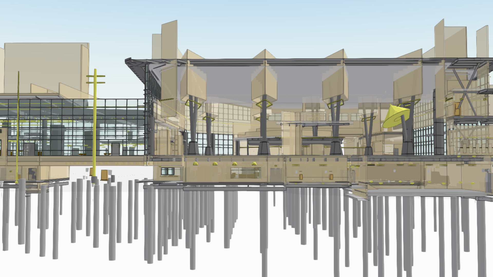
      <figcaption>
        
        
        IFC in ArcGIS in een 3D Object Scene Layers  
        Bron: <a href="https://www.esri.com/arcgis-blog/products/arcgis-pro/transportation/common-patterns-for-bim-and-gis-integration">Esri </a>
        
      </figcaption>
</figure>

## IFC2GeoJSON 
Het project [Ifc2GeoJSON](https://github.com/abdoulayediak/ifc2geojson) voorziet in tooling om IFC naar 3D GeoJSON te converteren. Ook is er een [ifc2gis-webapplicatie](https://ifc2gis.com/app/) van beschikbaar. 

<figure id="IFC-2-GIS" style="display: block; text-align: center; margin: 0 auto;">
      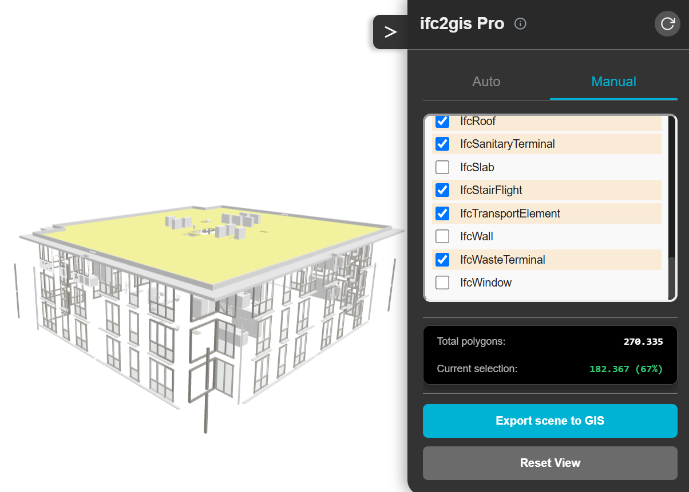
      <figcaption>
        
        
        IFC in ifc2gis: een gefilterde 1-op-1-vertaling op basis van een selectie 
        Bron: <a href="https://ifc2gis.com/">IFC2GIS </a>
        
      </figcaption>
</figure>

In deze tool worden web-ifc, three.js en GeoJSON gebruikt om de geometrie om te zetten. De [IfcGeometryLoader](https://github.com/ThatOpen/engine_web-ifc/blob/main/src/cpp/web-ifc/geometry/IfcGeometryLoader.cpp) voorziet in de transformatie van impliciete procedurele geometrie naar expliciete geometrie. Met deze functie is het mogelijk om parameters mee te geven voor het tesselleren van geometrie. In de Ifc2GeoJSON-tool is het niet mogelijk deze parameters aan te passen. 

## Safe Software FME
FME-software heeft verschillende functies beschikbaar om BIM naar Geo om te zetten. 

De functies verschillen in het detailniveau van het BIM-model en het detailniveau van de output. LoD 3 is hierbij het meest complex, omdat het geen n-op-1- of 1-op-1-mapping, maar een n-op-n-mapping (en dientengevolge conversie) is.   

- [Simplifying IFC geometries for easier conversion](https://support.safe.com/hc/en-us/articles/25407765402637-Simplifying-IFC-geometries-for-easier-conversion)  
- [BIM to GIS IFC LOD 100 to LOD 2 CityGML](https://support.safe.com/hc/en-us/articles/25407431004173-BIM-to-GIS-Basic-IFC-LOD-100-to-LOD-2-CityGML)  
- [BIM to GIS IFC LOD 200 to LOD 3 CityGML](https://support.safe.com/hc/en-us/articles/25407525412365-BIM-to-GIS-Advanced-IFC-LOD-200-to-LOD-3-CityGML)
- [BIM to GIS IFC LOD 300 to LOD 4 CityGML](https://support.safe.com/hc/en-us/articles/25407718003341-BIM-to-GIS-Intermediate-IFC-LOD-300-to-LOD-4-CityGML)

In de totale flow van de LOD 100 naar LoD2 CityGML-conversie is te zien dat er een mesh gemaakt wordt van de IFC-geometrie van spaces en slabs.  

<figure id="FME-LOD-2-workflow" style="display: block; text-align: center; margin: 0 auto;">
      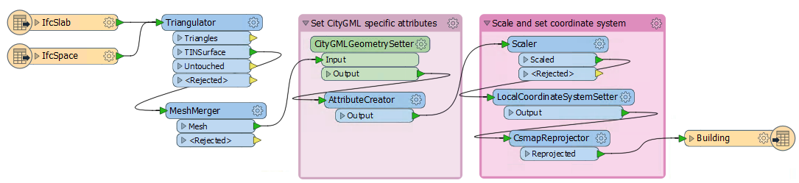
      <figcaption>
        
        
        FME LOD 2 CityGML workflow 
        Bron: <a href="https://support.safe.com/hc/en-us/articles/25407429026829-BIM-Tutorial">FME </a>
        
      </figcaption>
</figure>

De totale flow van de LOD 200 naar LoD3 CityGML-conversie is het meest complex. Voor een gebouw wordt er wederom een LOD 100-mesh gemaakt. Dit wordt aangevuld met een [citygmlgeometrysetter](https://hub.safe.com/publishers/safe-lab/transformers/citygmlgeometrysetter). Hiermee kan een bepaalde CityGML LoD geduid worden. Verschillende IFC-entiteiten resulteren in de flow in verschillende CityGML-concepten. 

<figure id="FME-LOD-3-workflow" style="display: block; text-align: center; margin: 0 auto;">
      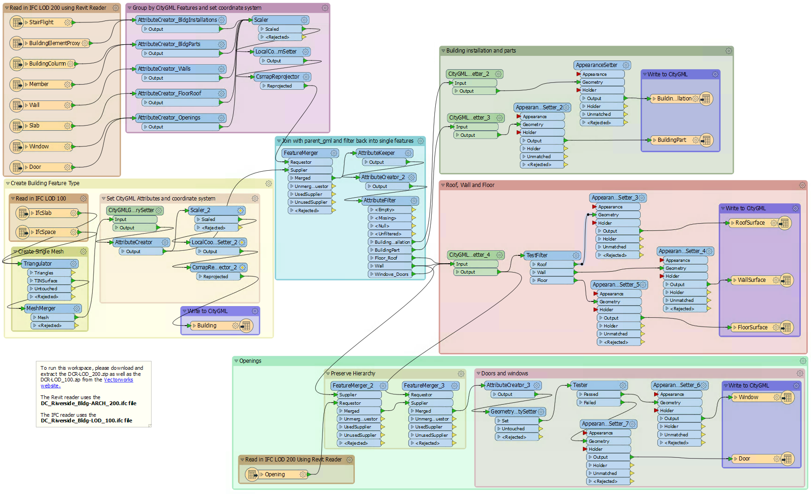
      <figcaption>
        
        
        FME LOD 3 CityGML workflow 
        Bron: <a href="https://support.safe.com/hc/en-us/articles/25407429026829-BIM-Tutorial">FME </a>
        
      </figcaption>
</figure>

<figure id="FME-IFC-Input-model" style="display: block; text-align: center; margin: 0 auto;">
      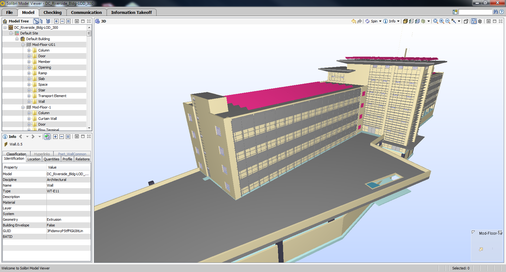
      <figcaption>
        
        
        FME IFC Input model 
        Bron: <a href="https://support.safe.com/hc/en-us/articles/25407429026829-BIM-Tutorial">FME </a>
        
      </figcaption>
</figure>

<figure id="FME-LOD-2-CityGML" style="display: block; text-align: center; margin: 0 auto;">
      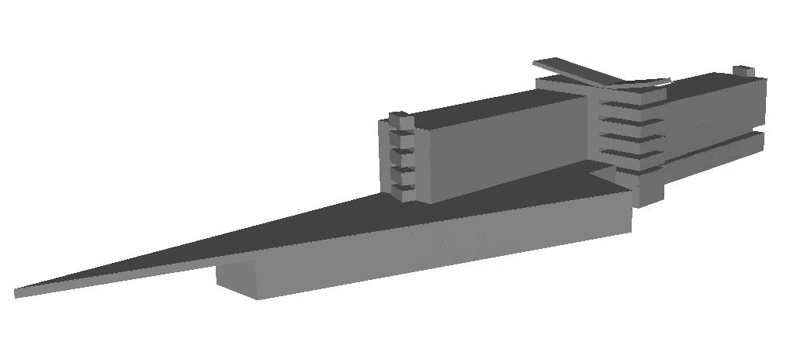
      <figcaption>
        
        
        FME LOD 2 CityGML output 
        Bron: <a href="https://support.safe.com/hc/en-us/articles/25407429026829-BIM-Tutorial">FME </a>
        
      </figcaption>
</figure>

<figure id="IFC-3-GIS" style="display: block; text-align: center; margin: 0 auto;">
      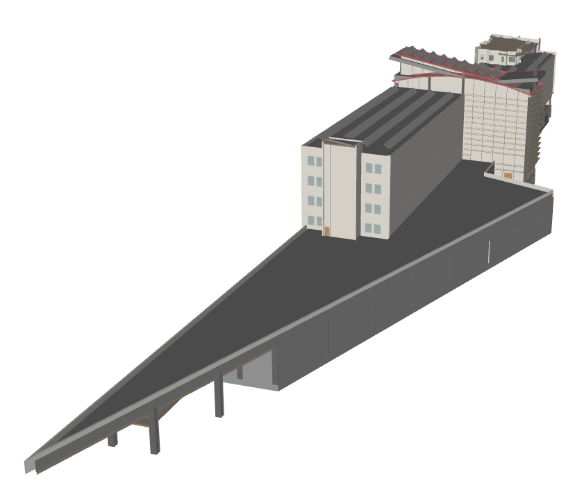
      <figcaption>
        
        
        FME LOD 3 CityGML output 
        Bron: <a href="https://support.safe.com/hc/en-us/articles/25407429026829-BIM-Tutorial">FME </a>
        
      </figcaption>
</figure>

<figure id="IFC-4-GIS" style="display: block; text-align: center; margin: 0 auto;">
      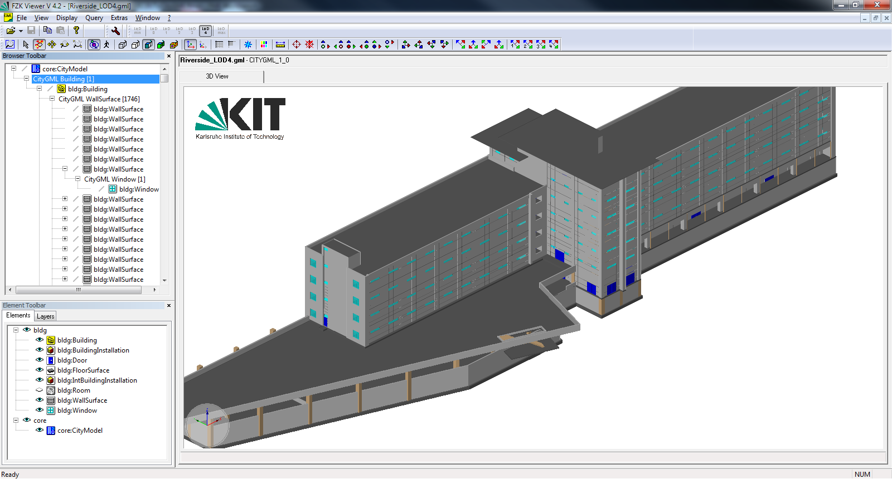
      <figcaption>
        
        
        FME LOD 4 CityGML output 
        Bron: <a href="https://support.safe.com/hc/en-us/articles/25407429026829-BIM-Tutorial">FME </a> 
        
      </figcaption>
</figure>

## IfcConvert
[IfcConvert](https://docs.ifcopenshell.org/ifcconvert.html#) is onderdeel van [IfcOpenShell](https://docs.ifcopenshell.org/). IfcOpenShell is een toolkit die ondersteunt bij het lezen, schrijven en bewerken van BIM met behulp van IFC. Met IfcConvert is het mogelijk om IFC te converteren naar formaten als .obj, .dae, .glb, .stp, .igs, .xml, .svg, .h5, .ttl, .ifc, .rdb en .json. 
Het is mogelijk om specifieke elementen wel of niet mee te nemen met IfcConvert, zoals beschreven in [IfcConvert Usage](https://docs.ifcopenshell.org/ifcconvert/usage.html). 

Het creëren van CityJSON is onderzocht in samenwerking met de TU Delft. Dit is onder andere beschreven in dit [GitHub-issue](https://github.com/IfcOpenShell/IfcOpenShell/issues/2977). IfcConvert voorziet momenteel niet in CityJSON-conversie. Wel is er een IfcCityJSON-converter, maar deze converter converteert CityJSON naar IFC, en niet andersom. 

<figure id="IFC-Open-Shell-CityGML-Output" style="display: block; text-align: center; margin: 0 auto;">
      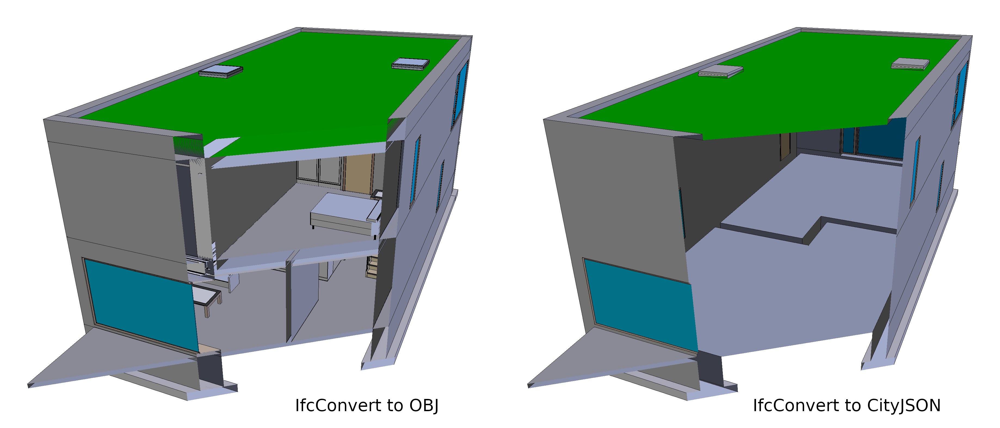
      <figcaption>
        
        
        IfcOpenShell-onderzoek naar OBJ- en CityGML-output vanuit IFC 
        Bron: <a href="https://github.com/IfcOpenShell/IfcOpenShell">IfcOpenShell GitHub</a>
        
      </figcaption>
</figure>

## BIMShell
BIMShell is een extensie voor Trimble SketchUp. Met deze extensie is het mogelijk om een footprint shell te maken. Dit genereert een omhulsel dat overeenkomt met de geëxtrudeerde voetafdruk van het model (langs de z-as).

Daarnaast is er de functie Voxel Shell. Deze genereert een "gesloten benadering van de buitencontour van het model met behulp van een voxelgegevensstructuur". Hierbij kan de voxelresolutie worden ingesteld die wordt gebruikt om een omhulsel te maken. 

Een kleinere resolutie zorgt voor een nauwkeuriger resultaat, maar vereist meer rekenkracht. Als het model openingen bevat die groter zijn dan de gekozen resolutie, is de kans groot dat het proces ook vlakken aan de binnenkant van het model genereert. Over het algemeen levert deze methode echter eenvoudigere modellen op dan de oorspronkelijke modellen.

Ten slotte is er de functie Out Shell Faces. Deze genereert een omhulselversie van het model door de vlakken die zich aan de buitenzijde bevinden te kopiëren. Hierbij kan de resolutie van het geoptimaliseerde raster worden ingesteld dat wordt gebruikt om vanaf de buitenzijde van het model stralen (rays) op het model af te vuren. Net als bij Voxel Shell geldt dat wanneer de binnen- en buitenruimte van het model niet goed van elkaar te onderscheiden zijn (bijvoorbeeld door openingen, een open deur of ramen), het resulterende omhullende model waarschijnlijk ook vlakken aan de binnenzijde zal bevatten.

<figure id="BIMShell-Input-Output" style="display: block; text-align: center; margin: 0 auto;">
      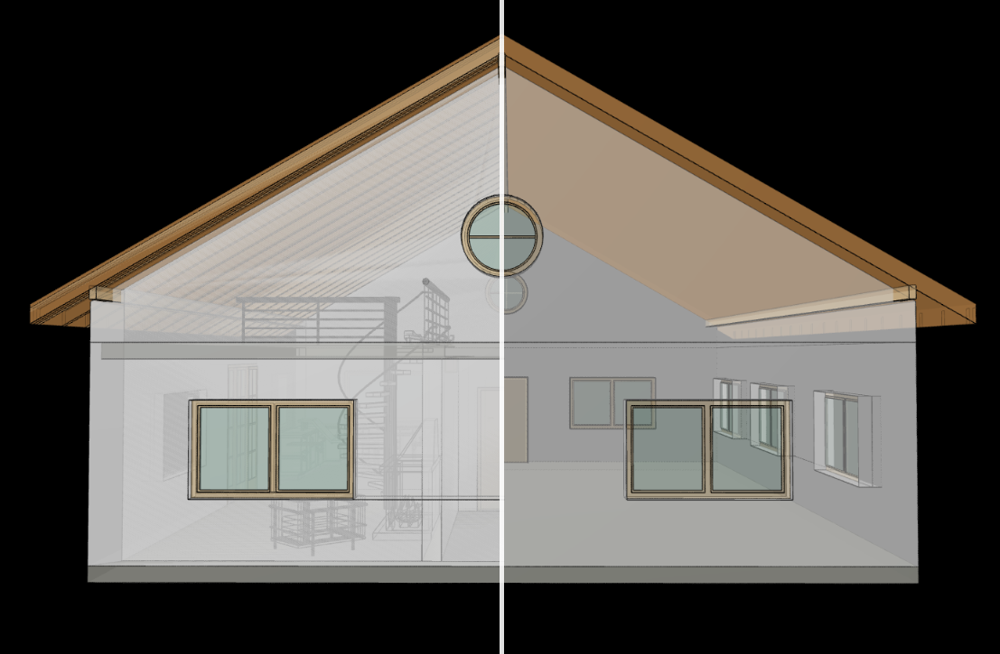
      <figcaption>
        
        
        BIMShell input and output model 
        Bron: <a href="https://extensions.sketchup.com/extension/cdd3801a-c15d-40f9-87c2-a729d55f60d4/bimshell">BIMShell SketchUp Extensions</a>
        
      </figcaption>
</figure>

<figure id="BIMShell-Input" style="display: block; text-align: center; margin: 0 auto;">
      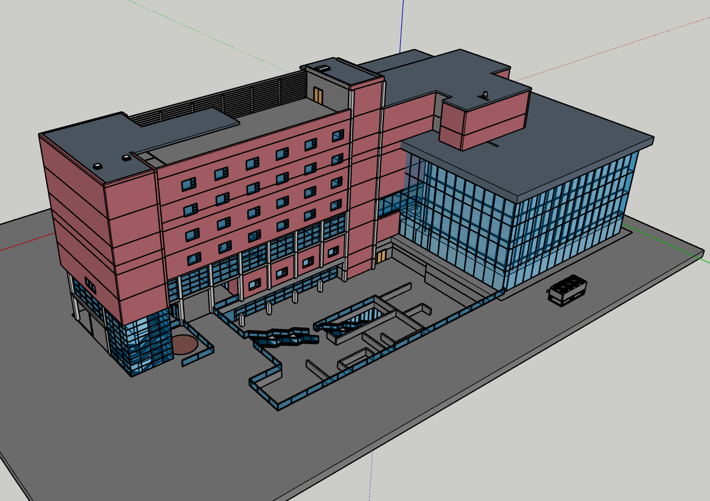
      <figcaption>
        
        
        BIMShell input model 
        Bron: <a href="https://extensions.sketchup.com/extension/cdd3801a-c15d-40f9-87c2-a729d55f60d4/bimshell">BIMShell SketchUp Extensions</a>
        
      </figcaption>
</figure>

<figure id="BIMShell-Output" style="display: block; text-align: center; margin: 0 auto;">
      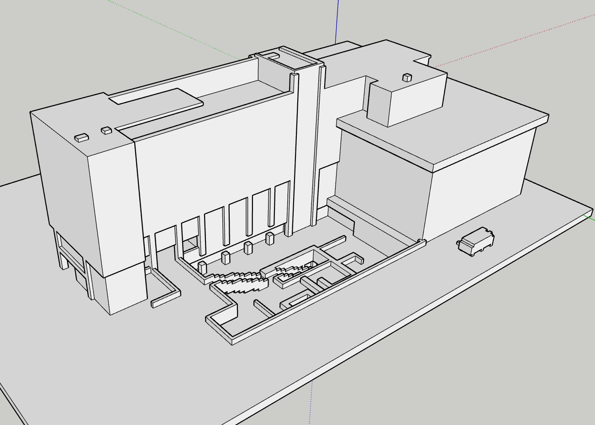
      <figcaption>
        
        
        BIMShell output model 
        Bron: <a href="https://extensions.sketchup.com/extension/cdd3801a-c15d-40f9-87c2-a729d55f60d4/bimshell">BIMShell SketchUp Extensions</a>
        
      </figcaption>
</figure>

## IfcEnvelopeExtractor

De IfcEnvelopeExtractor is een opensource-C++-applicatie die BIM-modellen in IFC-formaat kan omzetten naar Wavefront OBJ, STEP en CityJSON. Deze omzetting is niet alleen een 1-op-1-omzetting van IFC naar een GIS-bestandstype. De applicatie zet de geometrie van het inputbestand om naar GIS-representaties volgens de GIS-datastructuur. De conversie volgt hierbij het LoD-framework van Biljecki et al. [[BILJECKI2016]]. Aanvullend zijn er een aantal experimentele LoD's en een 1-op-1-conversie beschikbaar. De tool ondersteunt de conversie van IFC naar in totaal 17 verschillende LoD's, zie bijlage [Workflow IfcEnvelopeExtractor](#workflow-ifcenvelopeextractor) voor meer informatie.

De applicatie is toegankelijk via de [GitHub-pagina](https://github.com/tudelft3d/IFC_BuildingEnvExtractor). Hier zijn de broncode en gecompileerde programma's beschikbaar. De gecompileerde programma's zijn beschikbaar voor zowel Windows als Linux (Ubuntu). Gedetailleerde informatie over de methodes die ontwikkeld zijn in de code om de conversie uit te voeren, kan worden gevonden in het [technische rapport](https://research.tudelft.nl/en/publications/bim2geo-converter/) van versie 0.2.6. Dit rapport is gebaseerd op een eerdere versie van de code; versie 0.3.x is de huidige versie, waarbij de dieper liggende logica gelijk of vergelijkbaar is gebleven.

De applicatie kan op twee manieren worden bediend: via een Graphical User Interface (GUI) of via een configuratiebestand (ConfigJSON). De GUI is makkelijker en sneller om mee te werken, zeker voor gebruikers die geen programmeerervaring hebben. De GUI geeft echter enkel controle over een deel van alle beschikbare instellingen. Dit is gedaan om de menu's overzichtelijk te houden. De beschikbare instellingen zijn gekozen op basis van wat de meest gebruikte instellingen zijn. Als deze instellingen te beperkend zijn, moet er met de ConfigJSON gewerkt worden. De ConfigJSON is een lijst met instellingen in JSON-encoding.

De workflow van de IfcEnvelopeExtractor wordt beschreven in [Bijlage Workflow IfcEnvelopeExtractor](#workflow-ifcenvelopeextractor).

## IFC2GIS
ifc2gis is een webtool die IFC-bestanden (BIM) omzet naar GeoJSON-formaat, zodat ze bruikbaar zijn in GIS-toepassingen. De tool is bedoeld voor stedenbouwkundigen, architecten en ontwikkelaars die werken met digitale tweelingen en BIM. De tool Ifc2GeoJSON is momenteel als applicatie [ifc2gis](https://ifc2gis.com/app/) via het web te gebruiken. Zowel een volledige als een gefilterde 1-op-1-vertaling is mogelijk. De tool ondersteunt geen geometrische shell-extracties.