# Toepassingen

## Handleiding/HowTo

| Applicatie | BIM/IFC direct openen | 1:1 vertaling | Gefilterde 1:1 vertaling | Shell extractie | CityGML LoD support | CityJSON LoD support |
| - | - | - | - | - | - | - |
| ESRI ArcGIS Pro| ✅ | ✅ | ✅ | ❌ | ❌ | ❌ |
| IFC2GeoJSON | ❌ | ✅ | ✅ | ❌ | ❌ | ❌ |
| Save Software FME | ❌ | ✅ | ✅ | ❌ | ✅  | ❌ |
| IfcConvert | ❌ | ✅ | ✅ | ❌ | ❌ | ❌ |
| BIMShell | ❌ | ✅ | ✅ | ✅ | ❌ | ❌ |
| IfcEnvelopeExtractor | ❌ | ✅ | ✅ | ✅ | ✅ | ✅ |

✅ = volledige support
❌ = geen support

# BIM bestanden in GIS omgeving brengen

## ESRI ArcGIS Pro
In ESRI ArcGIS Pro zijn er tools beschikbaar om een bestaand BIM-model (IFC en Revit) om te zetten naar GEO. Er is tooling beschikbaar om BIM-modellen direct in de Esri software te laden. Een juiste geo-locatie te geven en te converteren naar een ESRI File GeoDataBase (.gdb). De beschikbaar tooling is beschreven op [Esri BIM en GIS](https://learn.arcgis.com/en/paths/bim-and-gis/) en op de [bimfile to geodatabase](https://doc.esri.com/en/arcgis-pro/latest/tool-reference/conversion/bimfile-to-geodatabase.html) webpagina's. 

Met deze tooling is het mogelijk een 1 op 1 vertaling van het BIM-model te maken. Wel zal de orginele geometrie vertaald worden naar een Multipatch zoals beschreven in deze [ARcGIS documentatie](https://doc.esri.com/en/arcgis-pro/latest/help/data/revit/adding-revit-data-to-arcgis-pro.html). 

In de Esri-blog ["Common Patterns for BIM and GIS Integration"](https://www.esri.com/arcgis-blog/products/arcgis-pro/transportation/common-patterns-for-bim-and-gis-integration) staat beschreven dat het mogelijk is om alle informatie-uitwisseling via open standaarden (o.a. IFC en CityGML) plaats te laten vinden. Het converteren van gegevens van de ene standaard naar de andere kent vergelijkbare problemen als klassieke ETL-workflows. Dit leidt tot gegevensverlies, omdat bepaalde domein- of disciplinespecifieke informatie ontbreekt en omdat er verschillen zijn in de complexiteit waarmee geometrie wordt weergegeven. Het gegevensverlies kan nog groter worden wanneer gegevens vanuit een leveranciersspecifiek formaat via meerdere open standaarden worden geconverteerd en uiteindelijk weer in een ander leveranciersspecifiek formaat terechtkomen. 

Esri ondersteunt deze aanpak doorgaans door gebruik te maken van bibliotheken en tools van derden om gegevens in open standaarden te kunnen lezen. Waar mogelijk wordt het aantal stappen in de gegevensconversie vereenvoudigd door te kijken naar ELT-workflows en -tools, bijvoorbeeld door IFC in de toekomst rechtstreeks in ArcGIS te kunnen lezen.
There are other patterns of integration that we see evolving in the industry. One of them is the concept that all information exchange should happen through Standards. This includes specifications such as the Open Geospatial Consortium’s CityGML and IFC. This can be challenging when the standards were created for separate industries and workflows and only later attempted to be glued together. Converting data from one standard to another has similar issues to classic ETL workflows, resulting in data loss because of missing domain or discipline information and mismatch in graphic complexity. Data loss can be magnified when converting out of one vendor format, through multiple open standard formats, and then into another vendor format.

Given the need to evolve software and standards rapidly to meet changing market expectation and technology capability, it’s hard to see that this pattern is going to be able to stabilize in a manner that consistently minimizes data loss for most cross-industry applications of BIM and GIS integration. Esri typically supports these patterns by making use of third-party libraries and tools to read open standard data. Whenever possible, we hope to simplify the number of hops in data conversion by looking at ELT workflows and tools, such as by directly reading IFC into ArcGIS in the future.

<figure id="IFC-in-ArcGIS" style="display: block; text-align: center; margin: 0 auto;">
      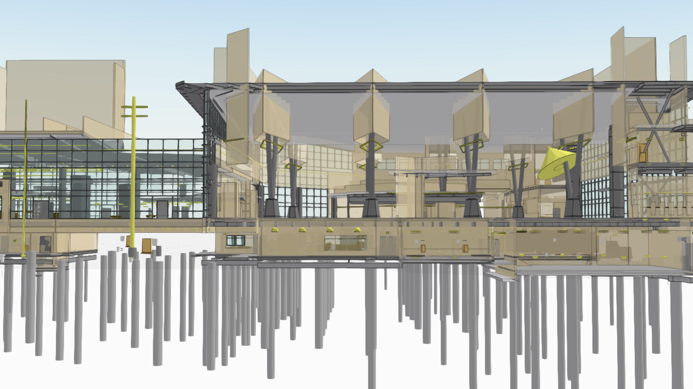
      <figcaption>
        
        
        IFC in ArcGIS in een 3D Object Scene Layers  
        Bron: <a href="https://www.esri.com/arcgis-blog/products/arcgis-pro/transportation/common-patterns-for-bim-and-gis-integration">Esri </a></a>
        
      </figcaption>
</figure>

## IFC2GeoJSON 
Het project [Ifc2GeoJSON](https://github.com/abdoulayediak/ifc2geojson) voorziet in tooling om IFC naar 3D GeoJSON te converteren. Ook is er een [ifc2gis-webapplicatie](https://ifc2gis.com/app/) van beschikbaar. 

<figure id="IFC-2-GIS" style="display: block; text-align: center; margin: 0 auto;">
      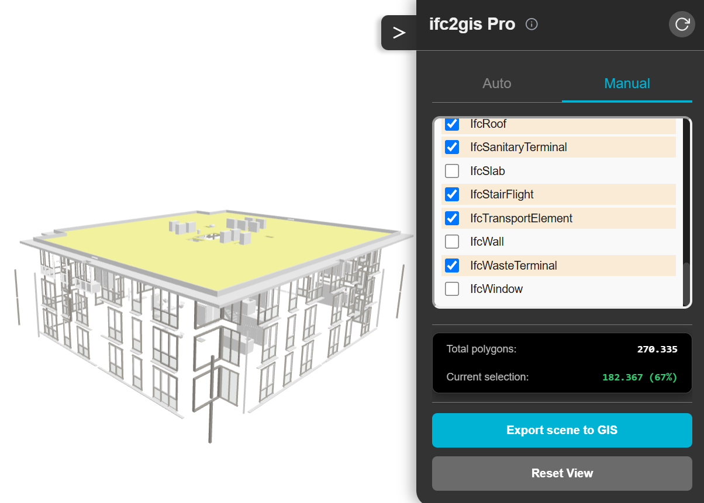
      <figcaption>
        
        
        IFC in de tooling IFC2GIS met een selectie een gefilterde 1:1 vertaling 
        Bron: <a href="https://ifc2gis.com/">IFC2GIS </a></a>
        
      </figcaption>
</figure>

In deze tool wordt web-ifc, tree.js en geojson gebruikt om de geometrie om te zetten. De [IfcGeometryLoader](https://github.com/ThatOpen/engine_web-ifc/blob/main/src/cpp/web-ifc/geometry/IfcGeometryLoader.cpp) voorziet in de transformatie van impliciete procedurele geometrie naar expliciete geometrie. Met deze functie is het mogelijk om parameters mee te geven voor het tesseleren van geometrie. In de Ifc2GeoJSON tool is het niet mogelijk deze parameters aan te passen. 

## Save Software FME
FME software heeft verschillende functies beschikbaar om BIM naar GEO om te zetten. 

De functies onderscheiden in het detailniveau van het BIM-model en het detailniveau van de output. LoD 3 is hierbij het meest complex, omdat het geen n op 1, geen 1 op 1 maar een n op n mapping (en dientengevolge conversie) is.   

- [Simplifying IFC geometries for easier conversion](https://support.safe.com/hc/en-us/articles/25407765402637-Simplifying-IFC-geometries-for-easier-conversion)  
- [BIM to GIS IFC LOD 100 to LOD 2 CityGML](https://support.safe.com/hc/en-us/articles/25407431004173-BIM-to-GIS-Basic-IFC-LOD-100-to-LOD-2-CityGML)  
- [BIM to GIS IFC LOD 200 to LOD 3 CityGML](https://support.safe.com/hc/en-us/articles/25407525412365-BIM-to-GIS-Advanced-IFC-LOD-200-to-LOD-3-CityGML)
- [BIM to GIS IFC LOD 300 to LOD 4 CityGML](https://support.safe.com/hc/en-us/articles/25407718003341-BIM-to-GIS-Intermediate-IFC-LOD-300-to-LOD-4-CityGML)

In de totale flow van de LOD100 naar LoD 2 CityGML conversie is te zien dat er een mesh gemaakt wordt van de Ifc geometrie van spaces en slabs.  

<figure id="FME-LOD-2-workflow" style="display: block; text-align: center; margin: 0 auto;">
      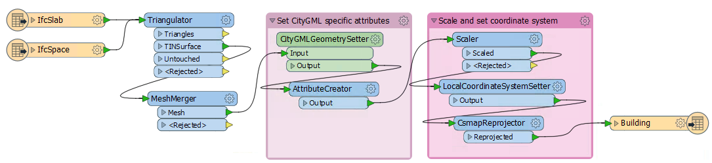
      <figcaption>
        
        
        FME LOD 2 CityGML workflow 
        Bron: <a href="https://support.safe.com/hc/en-us/articles/25407429026829-BIM-Tutorial">FME </a></a>
        
      </figcaption>
</figure>

De totale flow van de LOD200 naar LoD 3 CityGML conversie is het meest complex. Voor een gebouw wordt er wederom een LOD100 mesh gemaakt. Dit wordt aangevuld met een [citygmlgeometrysetter](https://hub.safe.com/publishers/safe-lab/transformers/citygmlgeometrysetter). Hiermeek kan een bepaalde CityGML LoD geduid worden. Verschillende Ifc entiteiten resulteren in de flow in verschillende CityGML concepten. 

<figure id="FME-LOD-3-workflow" style="display: block; text-align: center; margin: 0 auto;">
      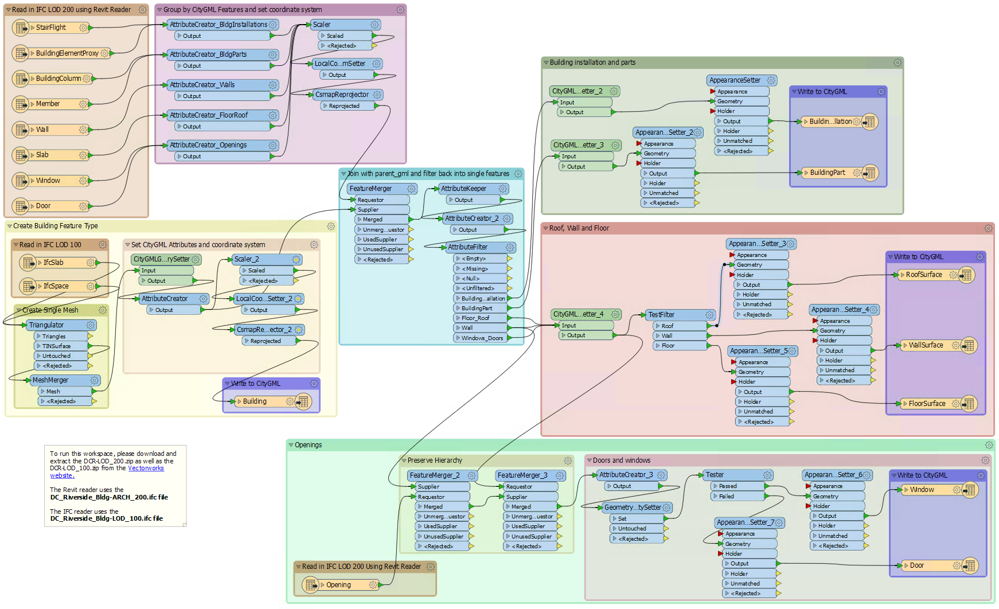
      <figcaption>
        
        
        FME LOD 3 CityGML workflow 
        Bron: <a href="https://support.safe.com/hc/en-us/articles/25407429026829-BIM-Tutorial">FME </a></a>
        
      </figcaption>
</figure>

<figure id="FME-IFC-Input-model" style="display: block; text-align: center; margin: 0 auto;">
      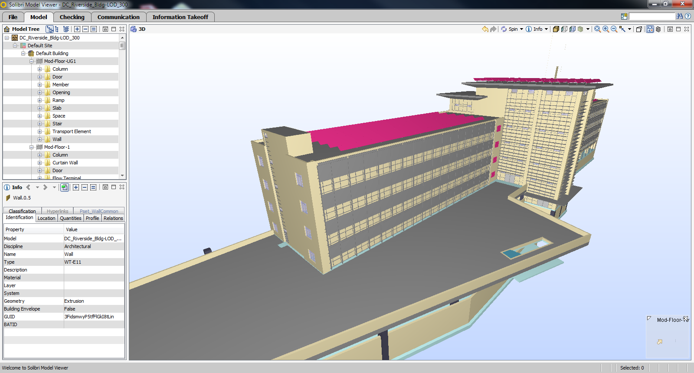
      <figcaption>
        
        
        FME IFC Input model 
        Bron: <a href="https://support.safe.com/hc/en-us/articles/25407429026829-BIM-Tutorial">FME </a></a>
        
      </figcaption>
</figure>

<figure id="FME-LOD-2-CityGML" style="display: block; text-align: center; margin: 0 auto;">
      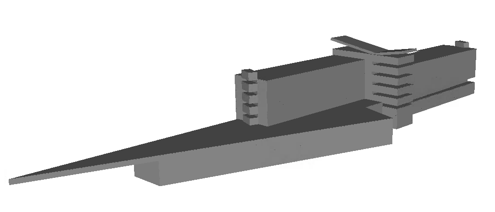
      <figcaption>
        
        
        FME LOD 2 CityGML output 
        Bron: <a href="https://support.safe.com/hc/en-us/articles/25407429026829-BIM-Tutorial">FME </a></a>
        
      </figcaption>
</figure>

<figure id="IFC-3-GIS" style="display: block; text-align: center; margin: 0 auto;">
      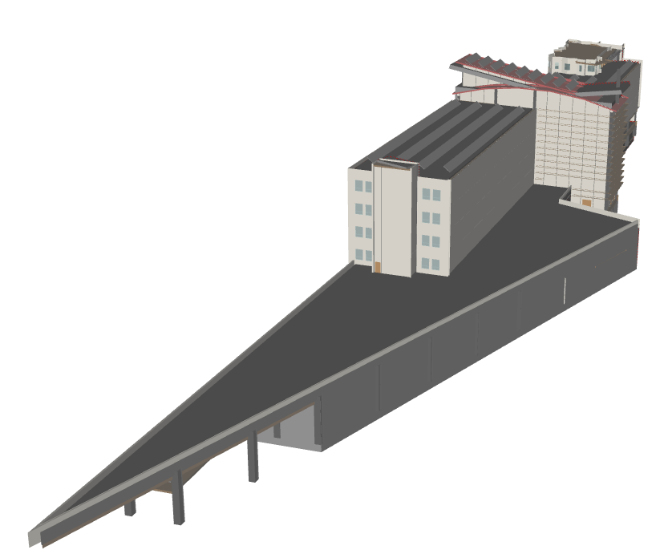
      <figcaption>
        
        
        FME LOD 3 CityGML output 
        Bron: <a href="https://support.safe.com/hc/en-us/articles/25407429026829-BIM-Tutorial">FME </a></a>
        
      </figcaption>
</figure>

<figure id="IFC-4-GIS" style="display: block; text-align: center; margin: 0 auto;">
      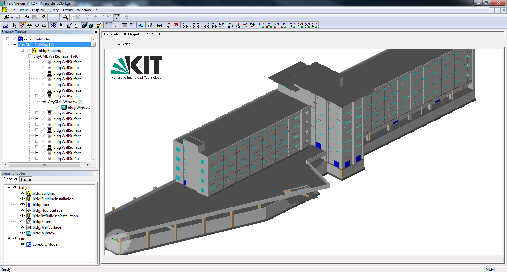
      <figcaption>
        
        
        FME LOD 4 CityGML output 
        Bron: <a href="https://support.safe.com/hc/en-us/articles/25407429026829-BIM-Tutorial">FME </a></a> 
        
      </figcaption>
</figure>

## IfcConvert
[IFC convert](https://docs.ifcopenshell.org/ifcconvert.html#) is onderdeel van [IfcOpenShell](https://docs.ifcopenshell.org/). IfcOpenShell is een toolkit die ondersteunt bij het lezen, schrijven en bewerken van BIM met behulp van IFC. Met IfcConvert is het mogelijk om IFC te converteren naar formaten als .obj, .dae, .glb, .stp, .igs, .xml, .svg, .h5, .ttl, .ifc, .rdb en .json. 
Het is mogelijk om specifieke elementen wel of niet mee te nemen met de IFCConvert tool zoals beschreven in de [IfcConver Usage](https://docs.ifcopenshell.org/ifcconvert/usage.html). 

Het creëeren van CityJSON is onderzocht in samenwerking met de TU-Delft. Dit is onder andere beschreven in dit [githubissue](https://github.com/IfcOpenShell/IfcOpenShell/issues/2977). IfcConvert voorziet momenteel niet in CityJSON conversie. Wel is er een IfcCityJSON converter, maar deze converter converteert CityJSON naar IFC, en niet andersom. 

<figure id="IFC-Open-Shell-CityGML-Output" style="display: block; text-align: center; margin: 0 auto;">
      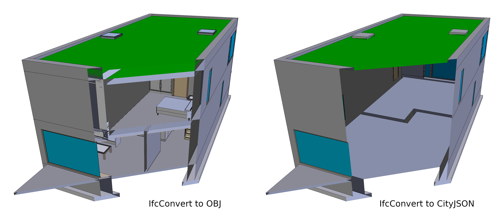
      <figcaption>
        
        
        Ifc Open shell onderzoek naar OBJ en CityGML output vanuit IFC 
        Bron: <a href="https://github.com/IfcOpenShell/IfcOpenShell">IFCOpenShell Github</a></a>
        
      </figcaption>
</figure>

## BIMShell
BIMShell is een extensie van Trimble/Sketchup. Met deze extensie is het mogelijk om een footprint shell te maken. Dit genereert een omhulsel dat overeenkomt met de geëxtrudeerde voetafdruk van het model (langs de Z-as)

Daarnaast bestaat de Voxel Shell functie. 
Dit genereert een "gesloten benadering van de buitencontour van het model met behulp van een voxelgegevensstructuur". Hierbij kun je de voxelsresolutie instellen die wordt gebruikt om een omhulsel te maken. 

Een kleinere resolutie zorgt voor een nauwkeuriger resultaat, maar vereist meer rekenkracht. Als het model openingen bevat die groter zijn dan de gekozen resolutie, is de kans groot dat het proces ook vlakken aan de binnenkant van het model genereert. Over het algemeen levert deze methode echter eenvoudigere modellen op dan de oorspronkelijke modellen.

Tenslotte is er de Out Shell Faces 
Deze genereert een omhulselversie van het model door de vlakken die zich aan de buitenzijde bevinden te kopiëren. Hierbij kan de resolutie van het geoptimaliseerde raster worden ingesteld dat wordt gebruikt om vanaf de buitenzijde van het model stralen (rays) op het model af te vuren. Net als bij Voxel Shell geldt dat wanneer de binnen- en buitenruimte van het model niet goed van elkaar te onderscheiden zijn (bijvoorbeeld door openingen, een open deur of ramen), het resulterende omhullende model waarschijnlijk ook vlakken aan de binnenzijde zal bevatten.

<figure id="BIMShell-Input-Output" style="display: block; text-align: center; margin: 0 auto;">
      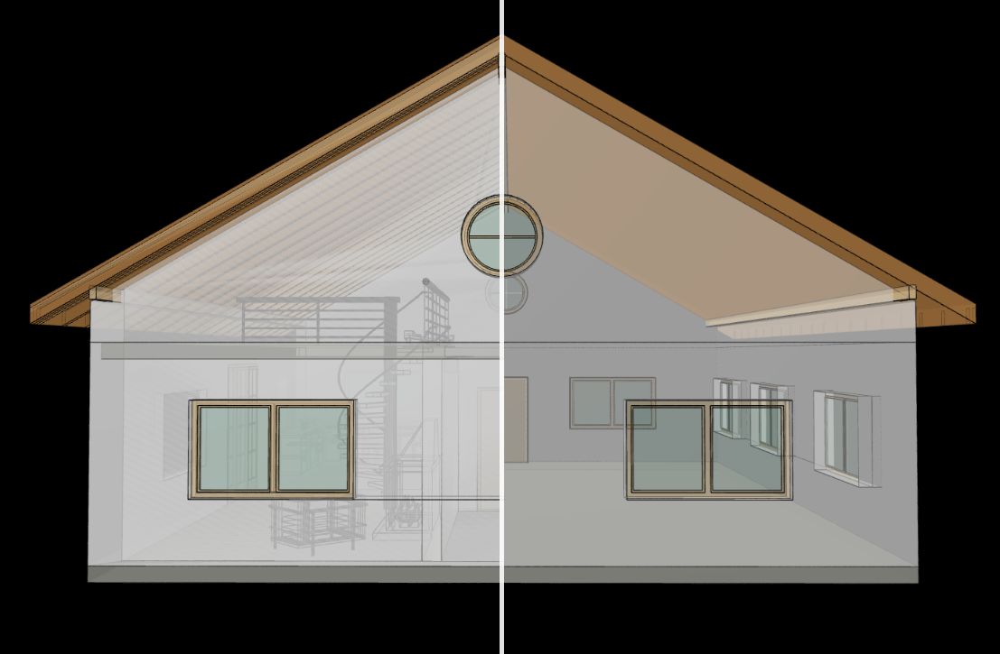
      <figcaption>
        
        
        BIMShell input and output model 
        Bron: <a href="https://extensions.sketchup.com/extension/cdd3801a-c15d-40f9-87c2-a729d55f60d4/bimshell">BIMShell SketchUp Extensions</a></a>
        
      </figcaption>
</figure>

<figure id="BIMShell-Input" style="display: block; text-align: center; margin: 0 auto;">
      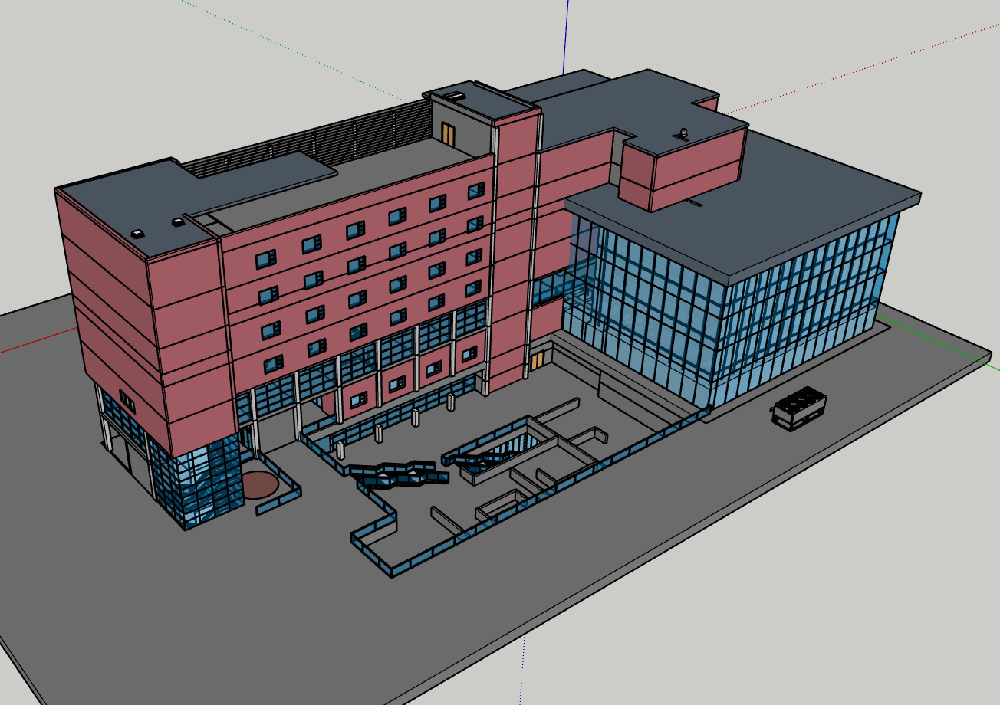
      <figcaption>
        
        
        BIMShell input model 
        Bron: <a href="https://extensions.sketchup.com/extension/cdd3801a-c15d-40f9-87c2-a729d55f60d4/bimshell">BIMShell SketchUp Extensions</a></a>
        
      </figcaption>
</figure>

<figure id="BIMShell-Output" style="display: block; text-align: center; margin: 0 auto;">
      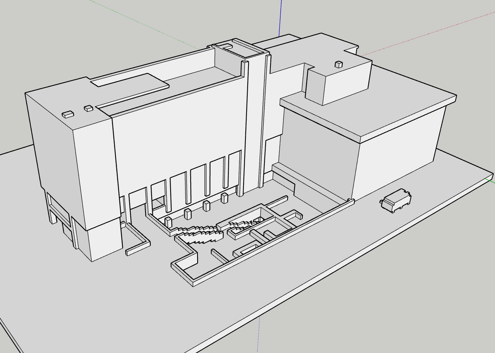
      <figcaption>
        
        
        BIMShell output model 
        Bron: <a href="https://extensions.sketchup.com/extension/cdd3801a-c15d-40f9-87c2-a729d55f60d4/bimshell">BIMShell SketchUp Extensions</a></a>
        
      </figcaption>
</figure>

## IfcEnvelopeExtractor

De IfcEnvelopeExtractor is een open source C++ applicatie die BIM modellen in de IFC encoding kan omzetten naar Wavefront OBJ, STEP en CityGML CityJSON. Deze omzetting is niet alleen een 1:1 omzetting van IFC naar een GIS bestandstype. De applicatie zet de geometrie van het input bestand om naar GIS representaties volgens de GIS syntax. De conversie volgt hierbij het LoD framework van [Biljecki et al.](https://pure.tudelft.nl/ws/portalfiles/portal/4377508/Biljecki2016to.pdf). Aanvullend zijn er een aantal experimentele LoDs en een 1:1 conversie beschikbaar. De tool support de conversie van IFC naar in totaal 17 verschillende LoDs, zie appendix ... voor meer informatie.

De applicatie is toegankelijk via de [GitHub pagina](https://github.com/tudelft3d/IFC_BuildingEnvExtractor). Hier zijn de source code en gecompilde executables beschikbaar. De gecompilede executables zijn beschikbaar voor zowel Windows als Linux (Ubuntu). Gedetaillerde informatie over de methodes die ontwikkeld zijn in de code om de conversie uit te voeren, kan worden gevonden in het [technische report](https://research.tudelft.nl/en/publications/bim2geo-converter/) van versie 0.2.6. Dit report is gebaseerd op een eerdere versie van de code, versie 0.3.x is de huidige versie, waarbij de dieper liggende logica gelijk of vergelijkbaar is gebleven.

Controle over de applicatie kan op twee manieren worden uitgeoefend, via een Graphical User Interface (GUI) of via een configuratie bestand (ConfigJSON). De GUI is makkelijker en sneller om mee te werken, zeker voor gebruikers die geen programmeer ervaring hebben. De GUI geeft echter enkel controle over een sub-set van alle beschikbare instellingen. Dit is gedaan om de menu's overzichtelijk te houden. De beschikbare instellingen zijn gekozen op basis van wat de meest gebruikte instellingen zijn. Als deze instellingen te beperkend zijn moet er met de ConfigJSON gewerkt worden. De ConfigJSON is een lijst met instellingen in een JSON encoding.

De workflow van de IfcEnvelopeExtractor wordt beschreven in [Bijlage Workflow IfcEnvelopExtractor](#workflow-IfcEnvelopExtractor)

## IFC2GeoJSON
ifc2gis is een gebruiksvriendelijke webtool die IFC-bestanden (BIM) omzet naar GeoJSON-formaat, zodat ze bruikbaar zijn in GIS-toepassingen. De tool is ideaal voor stedenbouwkundigen, architecten en ontwikkelaars die werken met digitale tweelingen en slimme steden. De tool Ifc2GeoJSON is momenteel als applicatie [ifc2gis](https://ifc2gis.com/app/) via het web te gebruiken. Conversies zijn te doen voor volledige 1-op-1-vertaling als via een gefilterde 1-op-1-vertaling. De tool ondersteunt geen geometrische shell-extracties.