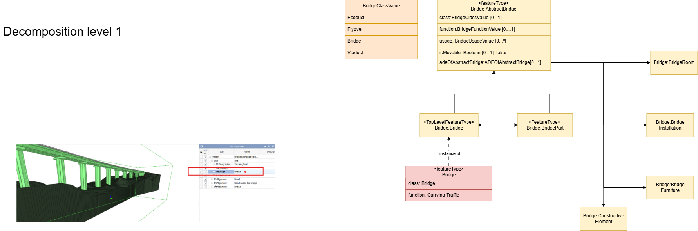
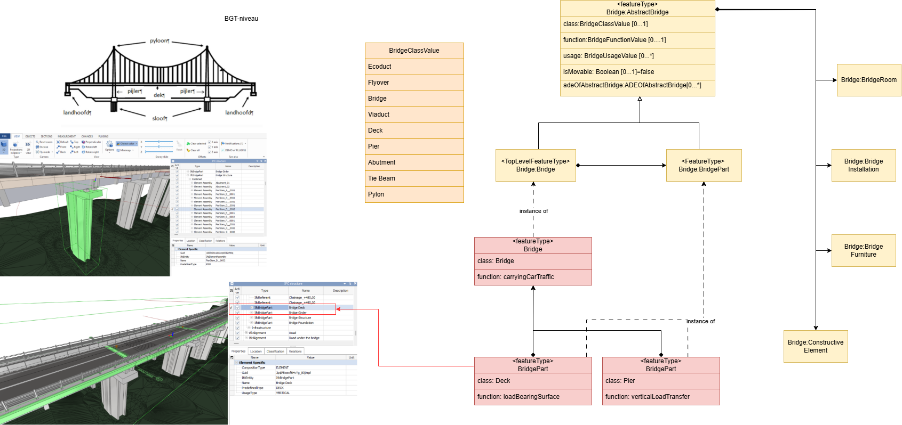
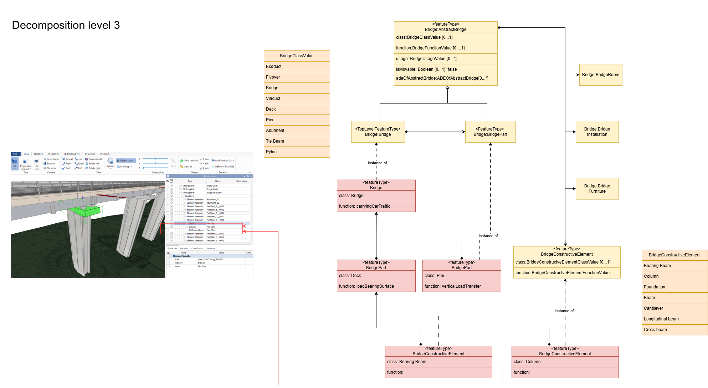
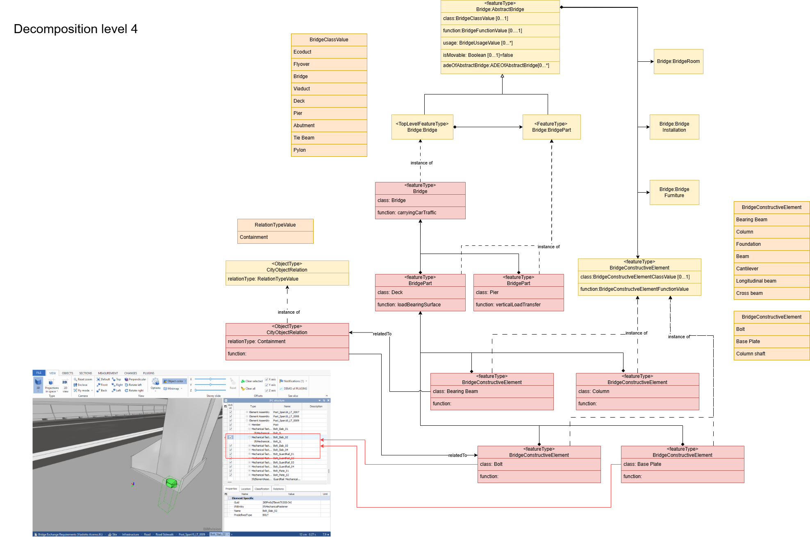

# Mapping tussen IFC en CityGML op verschillend decompositieniveau 

Vanuit een gedetailleerd BIM-model is het mogelijk om op verschillende decompositieniveaus naar GEO te mappen. 

Onderstaand voorbeeld laat zien dat vanuit eenzelfde IFC BIM-model van het Acerno Viaduct er verschillende transformaties mogelijk zijn. 


## Decompositieniveau 1: 


<figure id="Decompositie_niveau_1_IFC_naar_CityGML" style="display: block; text-align: center; margin: 0 auto;">
      
      <figcaption>
        <a class="self-link" href="#Decompositie_niveau_1_IFC_naar_CityGML"></a>
        <span class="fig-title">
        Decompositie niveau 1 IFC naar CityGML
      </figcaption>
</figure>

Voorbeeld CityGML beschrijving decompositieniveau 1: 

```xml
<?xml version="1.0" encoding="UTF-8"?>
<core:CityModel 	xmlns:core="http://www.opengis.net/citygml/3.0"
				xmlns:brid="http://www.opengis.net/citygml/bridge/3.0"
				xmlns:gml="http://www.opengis.net/gml"
				gml:id="citymodel_1">

	<core:cityObjectMember>
	    <brid:Bridge gml:id="bridge_1">
		<brid:class> Bridge </brid:class>
		<brid:function>carryingTraffic</brid:function>

		<brid:lod2Solid>
			<gml:Solid gml:id="solid_bridge_1">
				<gml:exterior>
					<gml:CompositeSurface>
						<gml:surfaceMember>
							<gml:Polygon>
								<gml:exterior>
									<gml:LinearRing>
										<gml:posList>
												0 0 0 30 0 0 30 6 0 0 6 0 0 0 0
										</gml:posList>
									</gml:LinearRing>
								</gml:exterior>
							</gml:Polygon>
						</gml:surfaceMember>
					</gml:CompositeSurface>
				</gml:exterior>
			</gml:Solid>
		</brid:lod2Solid>
	    </brid:Bridge>
	</core:cityObjectMember>
</core:CityModel>
```

# Decompositieniveau 2: 

<figure id="Decompositie_niveau_2_IFC_naar_CityGML" style="display: block; text-align: center; margin: 0 auto;">
      
      <figcaption>
        <a class="self-link" href="#Decompositie_niveau_2_IFC_naar_CityGML"></a>
        <span class="fig-title">
        Decompositie niveau 2 IFC naar CityGML
      </figcaption>
</figure>

Voorbeeld CityGML beschrijving decompositieniveau 2: 
```xml 
<?xml version="1.0" encoding="UTF-8"?>
<core:CityModel 	xmlns:core="http://www.opengis.net/citygml/3.0"
				xmlns:brid="http://www.opengis.net/citygml/bridge/3.0"
				xmlns:gml="http://www.opengis.net/gml"
				gml:id="citymodel_1">

	<core:cityObjectMember>
		<brid:Bridge gml:id="bridge_1">
			<brid:class>Bridge</brid:class>
			<brid:function>carryingTraffic</brid:function>
			<brid:bridgePart>
				<brid:BridgePart gml:id="bridge_part_deck">
					<brid:class>Deck</brid:class>
					<brid:function>loadBearingSurface</brid:function>
					<brid:lod2Solid>
						<gml:Solid gml:id="deck_solid">
							<gml:exterior>
								<gml:CompositeSurface>
									<gml:surfaceMember>
										<gml:Polygon>
											<gml:exterior>
												<gml:LinearRing>
													<gml:posList>
															0 0 5 30 0 5 30 6 5 0 6 5 0 0 5
													</gml:posList>
												</gml:LinearRing>
											</gml:exterior>
										</gml:Polygon>
									</gml:surfaceMember>
								</gml:CompositeSurface>
							</gml:exterior>
						</gml:Solid>
					</brid:lod2Solid>
				</brid:BridgePart>
			</brid:bridgePart>
			<brid:bridgePart>
				<brid:BridgePart gml:id="bridge_part_pier">
					<brid:class>Pier</brid:class>
					<brid:function>verticalLoadTransfer</brid:function>
					<brid:lod2Solid>
						<gml:Solid gml:id="pier_solid">
							<gml:exterior>
								<gml:CompositeSurface>
									<gml:surfaceMember>
										<gml:Polygon>
											<gml:exterior>
												<gml:LinearRing>
													<gml:posList>
														10 2 0 12 2 0 12 4 0 10 4 0 10 2 0
													</gml:posList>
												</gml:LinearRing>
											</gml:exterior>
										</gml:Polygon>
									</gml:surfaceMember>
								</gml:CompositeSurface>
							</gml:exterior>
						</gml:Solid>
					</brid:lod2Solid>
				</brid:BridgePart>
			</brid:bridgePart>
		</brid:Bridge>
	</core:cityObjectMember>
</core:CityModel>
```

# Decompositieniveau 3: 
<figure id="Decompositie_niveau_3_IFC_naar_CityGML" style="display: block; text-align: center; margin: 0 auto;">
      
      <figcaption>
        <a class="self-link" href="#Decompositie_niveau_3_IFC_naar_CityGML"></a>
        <span class="fig-title">
        Decompositie niveau 3 IFC naar CityGML
      </figcaption>
</figure>


# Decompositieniveau 4: 
<figure id="Decompositie_niveau_4_IFC_naar_CityGML" style="display: block; text-align: center; margin: 0 auto;">
      
      <figcaption>
        <a class="self-link" href="#Decompositie_niveau_4_IFC_naar_CityGML"></a>
        <span class="fig-title">
        Decompositie niveau 4 IFC naar CityGML
      </figcaption>
</figure>
