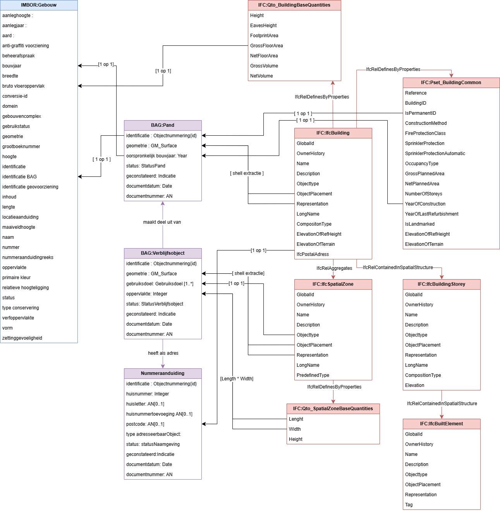
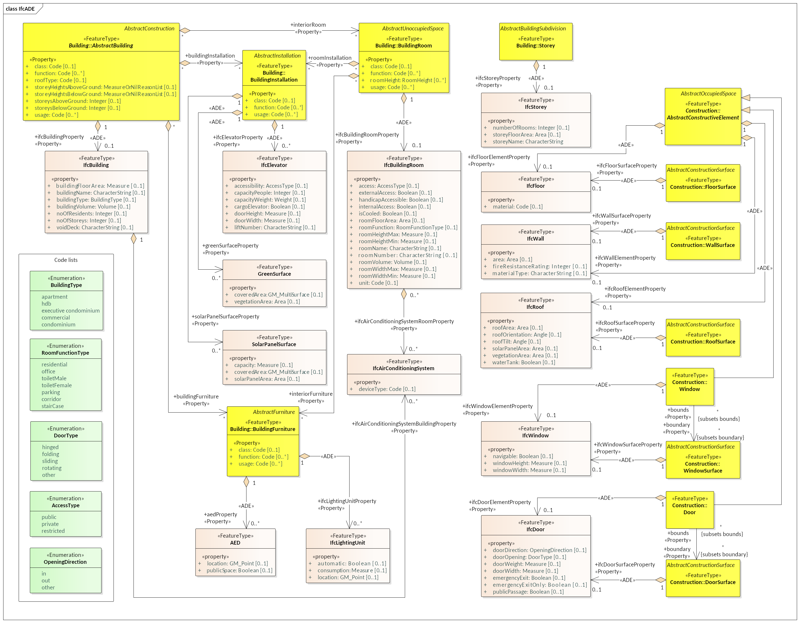

# Entiteit en Attribuutmapping tussen BIM en Geo

Deze bijlage geeft twee voorbeelden bij het hoofdstuk [Entiteit en attribuut BIM naar Geo](#entiteit-en-attribuut-bim-naar-geo). De eerste figuur laat zien hoe IFC-entiteiten en -attributen kunnen worden gemapt naar de BAG-objecten Pand, Verblijfsobject en Nummeraanduiding en naar het IMBOR-object Gebouw.

<figure id="Attribuut_mapping_IFC_BAG_IMBOR" style="display: block; text-align: center; margin: 0 auto;">
      
      <figcaption>
        
        
        Attribuutmapping van IFC-entiteiten en -attributen naar BAG- en IMBOR-entiteiten en -attributen.
        
      </figcaption>
</figure>

De tweede figuur toont een Application Domain Extension (ADE) waarmee IFC-informatie die niet in het standaard CityGML-model past, toch in CityGML kan worden vastgelegd.

<figure id="ADE_voor_IFC_in_CitygML" style="display: block; text-align: center; margin: 0 auto;">
      
      <figcaption>
        
        
        ADE voor CityGML om IFC-informatie te borgen.
        
      </figcaption>
</figure>
