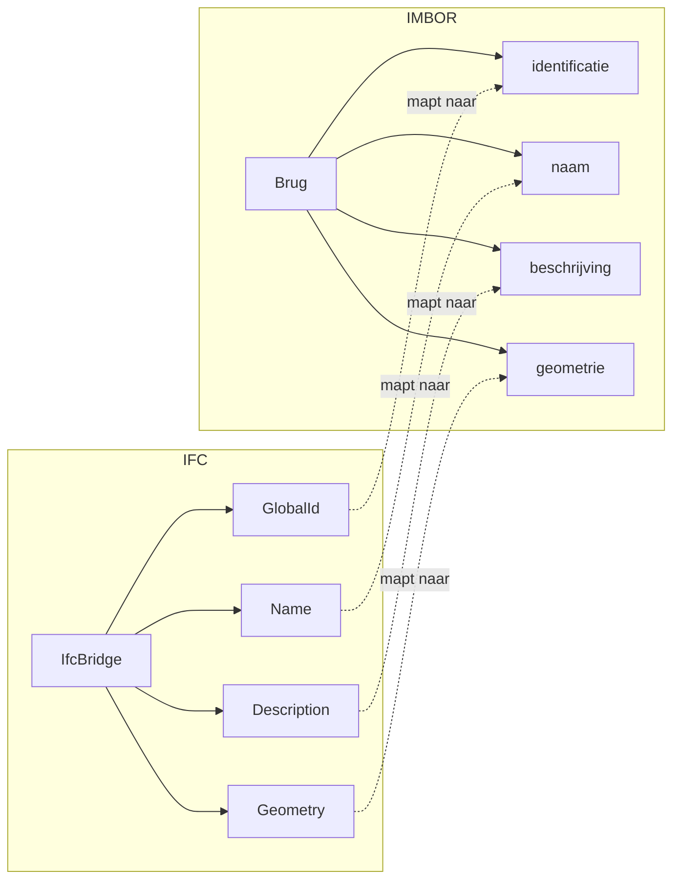

# IFC naar IMBOR Mapping

Deze bijlage geeft een eerste voorbeeld van een **semantische mapping** van **IFC 4.3** naar **IMBOR 2025** (InformatieModel Beheer Openbare Ruimte). In tegenstelling tot de CityGML-mapping in [bijlage A](#mapping-tussen-ifc-en-citygml-op-verschillend-decompositieniveau) richt deze mapping zich op **beheeraspecten** van infrastructurele objecten.

Het voorbeeld beperkt zich tot de entiteit `IfcBridge` en de IMBOR-klasse Brug, met een aantal basisattributen. Een volledige mapping, bijvoorbeeld voor dek, pijler en de attributen uit de IMBOR Startset, moet nog worden uitgewerkt.

## Attribuutmapping IfcBridge – IMBOR Brug

